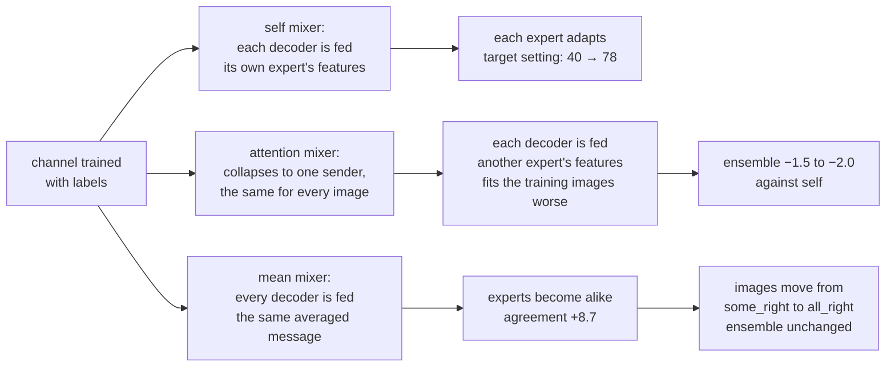

# Communicative Ensembles: Meeting Notes

**Presenters:** Samyar Goodarzi & Ali Al Hamadani
**Date:** 2026-11-16

## Updates Since Last Meeting

### Finer-Grained Agreement Metrics

- Last meeting it was pointed out that our agreement rate may be too coarse.
  It compares only the top answer of each pair of experts:

$$
\text{agreement} = \operatorname*{mean}_n \; \operatorname*{mean}_{i < j} \, \big[\, \hat y_{n,i} = \hat y_{n,j} \,\big],
$$

  where $\hat y_{n,i}$ is expert $i$'s most likely class on image $n$.

- We have generalised it to the **top-$k$ overlap**. Write
  $\operatorname{top}_k(n, i)$ for the set of expert $i$'s $k$ most likely
  classes on image $n$:

$$
\text{top-}k\text{ overlap} = \operatorname*{mean}_n \; \operatorname*{mean}_{i < j} \, \frac{\lvert \operatorname{top}_k(n, i) \cap \operatorname{top}_k(n, j) \rvert}{k} .
$$

  In words:
    - For every image and every pair of experts, take each expert's shortlist
      of its $k$ most likely classes.
    - Count how many classes the two shortlists share, and divide by $k$.
    - Average over pairs of experts, then over images.

  At $k = 1$ it is the agreement rate. It is logged for $k = 2$ and $3$, before
  and after communication.
- How to read it:
    - **Order within a shortlist doesn't count.** An expert answering shirt
      with coat second and one answering coat with shirt second share their
      whole top 2. Read with the agreement rate, it separates experts that
      disagree on everything from experts that consider the same few classes
      and pick differently.
    - **It isn't a looser agreement.** Experts can agree on the answer more
      often than on the runner-up, so the top-2 overlap can sit below the
      agreement rate.
    - **Chance is $k / C$**, for $C$ classes: 0.2 and 0.3 with 10 classes.
    - **It uses only the ranking, not the probabilities.** It still sees
      runners-up that an expert gives almost no probability. On Fashion-MNIST
      the second class gets a median probability of 0.006, yet two experts
      trained from different seeds share 0.84 of their top 2 before
      communication.

### Negative Correlation at $\lambda = 0$: No Error in the Code

- Last meeting a discrepancy was pointed out. At $\lambda = 0$ (no penalty),
  the negative-correlation experts should be ordinary independent experts, yet
  they looked unlike the baseline pool:
    - individual accuracy 89.7% against 84.3%;
    - agreement 94.1% against 81.8%.

  We were asked to check the code for an error.
- There is no error. The two pools are generated differently:

| | Baseline pool | Negative Corr., $\lambda = 0$ |
|---|---|---|
| Class mix | each expert its own, from Dirichlet($\alpha = 1$) | every class equally (no skew) |
| Sampling | with replacement, by the expert's class mix | every image once per epoch |
| Batch order | each expert its own | shared: all experts train on the same batches |
| Initialisation | each expert its own | each expert its own |

- So at $\lambda = 0$, initialisation is the only thing that differs between
  the experts:
    - Each sees every class in equal proportion, so each is more accurate on
      its own.
    - All see the same batches in the same order, so they agree more.
- Baseline experts differ in class mix, batch order and initialisation.

### Directional Metrics for Queries and Keys

- New metric, the **Q/K cosine gap**: how far apart each receiver's query puts
  the senders, by direction alone. With $q_{n,r}$ receiver $r$'s query and
  $k_{n,s}$ sender $s$'s key on image $n$ ($s$ includes $r$ itself):

$$
\text{Q/K cosine gap} = \operatorname*{mean}_{n,r} \Big( \max_s \cos(q_{n,r}, k_{n,s}) - \min_s \cos(q_{n,r}, k_{n,s}) \Big) .
$$

  It lies between 0 and 2:
    - near 0, a receiver's query sits at the same angle to every sender's key,
      so direction can't tell the senders apart;
    - near 2, the query points along one sender's key and away from another's.
- It is logged every epoch, so it shows how the directions change over
  training:
    - a growing gap means the queries and keys are turning to separate the
      senders;
    - a flat gap means only their lengths can sharpen the attention.
- Read with the metrics already logged:
    - **Query and key norms**: sharpening by length. Falling attention entropy
      with a flat gap and growing norms is sharpening by length; a growing gap
      is sharpening by direction.
    - **Route flip rate**: the share of (image, receiver) pairs whose
      most-heard sender changed since the previous epoch. 0 means routing has
      frozen; 2/3 (with 3 experts) is what re-drawing it at random would give.
    - **Routing mode share**: the share of images routed the most common way.
      1 means the same wiring for every image.

### Class Skew, and an Alternative: Disjoint Class Subsets

- Last meeting there was a concern that the Dirichlet class skew doesn't
  sample with replacement. We have checked that it does:
    - Each expert gets its own class mix, $\pi \sim \operatorname{Dirichlet}(\alpha
      \mathbf{1})$ with $\alpha = 1$.
    - An epoch is $N$ independent draws, where $N$ is the size of the expert
      split. Each draw picks a class $c$ with probability $\pi_c$, then an image
      of that class uniformly at random. The image goes back before the next
      draw.
    - So image $n$ is drawn with probability $\pi_{y_n} / N_{y_n}$, where
      $N_{y_n}$ is the number of images of its class.
    - An expert sees its favoured classes many times an epoch, repeats images,
      and rarely sees the rest. Every expert still takes the same number of
      steps.
- Following the professor's recommendation, we have also built an alternative
  oversampling mechanism, **disjoint class subsets**:
    - For each trial seed, the classes are shuffled and split into $M$ disjoint
      subsets, as evenly as they divide: 4, 3 and 3 of 10 classes for
      $M = 3$. Each expert owns one subset.
    - In place of a Dirichlet mix, each expert's class distribution is
      "one-hot" over the subsets: it sees only its own classes.
    - A slack parameter $\varepsilon$ softens this, in the manner of
      $\varepsilon$-greedy. Each draw comes from the expert's own classes with
      probability $1 - \varepsilon$, and from the rest of the data with
      probability $\varepsilon$, uniformly over images in each case. With
      $S_i$ the images of expert $i$'s classes:

$$
P(\text{draw image } n) =
\begin{cases}
(1 - \varepsilon) / \lvert S_i \rvert & \text{if } n \in S_i, \\
\varepsilon / (N - \lvert S_i \rvert) & \text{otherwise.}
\end{cases}
$$

    - At $\varepsilon = 0$ an expert never sees another class. As
      $\varepsilon$ rises its draws approach uniform over the whole split.
    - Sampling is still with replacement, $N$ draws an epoch, as with class
      skew.
- A control, **data shards**, gives each expert its own disjoint share of the
  images (40%, 30% and 30%), with every class in each share. It has the same
  amount of data per expert as the disjoint subsets, but no class
  specialisation.
- The study comparing these mechanisms is still running and isn't reported
  here.

## Summary of Experiments

- Normalising the query and key stops attention from collapsing onto one
  sender. Routing then varies from image to image, but accuracy doesn't move.
- Training each expert on its own loss gives a slightly better ensemble than
  training on the ensemble's loss. Self-Routing gains just as much, so the gain
  doesn't come from communication.
- With experts trained on different digit datasets, a channel raises their
  accuracy on a dataset none of them saw: by about 38 points when it trains on
  that dataset, and by 12 to 15 when it trains only on the experts' own
  datasets.
- Self-Routing is as good as or better than every mixer that communicates
  there too, and plain attention is 0.6 to 2.0 points worse.
- In all three studies the gains come from each expert's own channel, not from
  hearing the others.

## Shared Setup

- The first two studies reuse last meeting's baseline:
    - Each trial seed generates a fresh pool of 3 experts with class skew
      (Dirichlet $\alpha = 1$) on Fashion-MNIST. The experts are then frozen,
      and only the channel trains.
    - Learning rate $10^{-3}$, taper $r = 8$, Q and K of size 16, V of size 64.
    - Two architectures from last meeting: **Linear**, and **Non-Linear Encoder
      & Decoder**, each run forwards and backwards.
- Four mixers:
    - **Attention-Routing**
    - **QK-Norm Attention-Routing** (new, below)
    - **Self-Routing**: each expert hears only its own message
    - **Mean-Routing**: each expert hears the plain average of every message
- The first two studies are smaller than last meeting's: **5 trial seeds (0–4) and 10
  joint epochs**, against 15 and 30.
    - 5 seeds can't separate differences under about 0.2 points.
    - The accuracies aren't comparable to last meeting's overview table. Arms
      are compared within each study, paired by trial seed.
- Same scoring as before: the median test accuracy over the 5 epochs around
  each run's best `joint_val` epoch.
- Every $\pm$ below is a standard error over the 5 trial seeds.
- The third study, on experts from different datasets, has its own setup,
  given in its section.

## Experimentation: QK-Norm Attention

### Setup

- Last meeting, two problems with plain Attention-Routing:
    - It collapsed onto one sender when the sender was linear.
    - It never beat Self-Routing.
- Question: if attention can't collapse, does it start using the other
  experts' messages?
- **QK-Norm Attention-Routing** divides the query and key by their RMS before
  the dot product, with no learned gain. It adds no parameters.
    - It is the same computation as last meeting's Cosine-Attention-Routing.
      That was run forwards on the Linear channel only; it now runs in both
      directions and at both architectures.
    - The normed query is $\hat q = q / \operatorname{rms}(q)$ and the normed
      key is $\hat k = k / \operatorname{rms}(k)$.
    - Both have length $\sqrt{d_k}$.
    - The attention logit then depends only on the angle between query and
      key:

$$
w_{ij} = \operatorname{softmax}_j\!\left(\frac{\hat q_i \cdot \hat k_j}{\sqrt{d_k}}\right)
       = \operatorname{softmax}_j\big(\sqrt{d_k}\,\cos(q_i, k_j)\big)
       = \operatorname{softmax}_j\big(4 \cos(q_i, k_j)\big), \qquad d_k = 16,
$$

  so every logit lies in $[-4, 4]$.

- Sharpening is measured both ways: by length with the query and key norms,
  and by direction with the Q/K cosine gap (see Updates above).

### Results

#### QK-Norm Stops the Collapse

| Architecture | Mixer | Largest Attn. Weight | Attention Entropy | Q/K Cosine Gap | Query Norm | Routing Mode Share | Route Flip Rate |
|---|---|---|---|---|---|---|---|
| *Forwards* | | | | | | | |
| Linear | Attention | 1.00 ± 0.00 | 0.01 ± 0.00 | 0.87 ± 0.04 | 26.7 ± 2.8 | 0.82 ± 0.11 | 0.12 ± 0.07 |
| Linear | RMS-Norm Attention | 0.63 ± 0.02 | 0.83 ± 0.03 | 0.45 ± 0.04 | 19.6 ± 1.0 | 0.33 ± 0.09 | 0.27 ± 0.04 |
| Non-Linear Encoder & Decoder | Attention | 0.98 ± 0.01 | 0.06 ± 0.02 | 0.76 ± 0.05 | 15.7 ± 4.3 | 0.80 ± 0.12 | 0.06 ± 0.04 |
| Non-Linear Encoder & Decoder | RMS-Norm Attention | 0.64 ± 0.01 | 0.81 ± 0.02 | 0.50 ± 0.02 | 11.3 ± 0.7 | 0.59 ± 0.11 | 0.12 ± 0.03 |
| *Backwards* | | | | | | | |
| Linear | Attention | 0.99 ± 0.00 | 0.02 ± 0.01 | 0.82 ± 0.04 | 20.1 ± 2.6 | 0.66 ± 0.09 | 0.14 ± 0.04 |
| Linear | RMS-Norm Attention | 0.65 ± 0.04 | 0.80 ± 0.06 | 0.50 ± 0.06 | 18.4 ± 1.3 | 0.50 ± 0.12 | 0.19 ± 0.05 |
| Non-Linear Encoder & Decoder | Attention | 0.92 ± 0.06 | 0.18 ± 0.13 | 0.73 ± 0.09 | 12.2 ± 3.1 | 0.91 ± 0.07 | 0.05 ± 0.03 |
| Non-Linear Encoder & Decoder | RMS-Norm Attention | 0.64 ± 0.02 | 0.80 ± 0.03 | 0.48 ± 0.03 | 10.2 ± 0.3 | 0.42 ± 0.06 | 0.16 ± 0.02 |

*Uniform attention over 3 senders has a largest weight of 1/3 and an entropy of
log 3 ≈ 1.10. Routing mode share is the share of images routed the most common
way; route flip rate is the share of routes that changed since the previous
epoch. Query norms are measured on the encoder's output, before the norm.
Before training: cosine gap 0.39–0.42, query norm 1.0–1.7.*

- Plain attention collapses: the largest weight reaches 0.92–1.00, and most
  images are routed the same way. With QK-Norm the largest weight settles near
  0.64 in every setting.
- Plain attention sharpens mostly through length and partly through direction:
  query norms grow 10–20×, and the cosine gap roughly doubles. Under QK-Norm
  the cosine gap stays flat at 0.45–0.50.

#### Softer Routing Still Doesn't Help Accuracy

| Architecture | Attention | QK-Norm | Self | Mean |
|---|---|---|---|---|
| *Forwards* | | | | |
| Linear | 90.18 ± 0.12 | 90.27 ± 0.14 | 90.18 ± 0.13 | 90.29 ± 0.16 |
| Non-Linear Encoder & Decoder | 90.16 ± 0.14 | 90.14 ± 0.17 | 90.17 ± 0.17 | 90.20 ± 0.15 |
| *Backwards* | | | | |
| Linear | 90.16 ± 0.18 | 90.25 ± 0.16 | 90.26 ± 0.18 | 90.36 ± 0.18 |
| Non-Linear Encoder & Decoder | 90.21 ± 0.18 | 90.17 ± 0.23 | 90.12 ± 0.22 | 90.26 ± 0.17 |

*Test accuracy (%) ± standard error.*

- Every mixer scores between 90.1 and 90.4 in every setting.

| Architecture | QK-Norm $-$ Attn | QK-Norm $-$ Self | QK-Norm $-$ Mean | Attn $-$ Self | Mean $-$ Self |
|---|---|---|---|---|---|
| *Forwards* | | | | | |
| Linear | +0.09 ± 0.07 | +0.10 ± 0.03 | −0.02 ± 0.09 | 0.00 ± 0.06 | +0.11 ± 0.08 |
| Non-Linear Encoder & Decoder | −0.02 ± 0.06 | −0.04 ± 0.03 | −0.06 ± 0.03 | −0.02 ± 0.06 | +0.02 ± 0.03 |
| *Backwards* | | | | | |
| Linear | +0.08 ± 0.05 | −0.01 ± 0.05 | −0.12 ± 0.08 | −0.10 ± 0.05 | +0.10 ± 0.07 |
| Non-Linear Encoder & Decoder | −0.04 ± 0.06 | +0.04 ± 0.03 | −0.09 ± 0.07 | +0.08 ± 0.05 | +0.14 ± 0.05 |

*Difference in test accuracy (percentage points) ± standard error, paired by
trial seed.*

- No difference reaches 0.2 points, and no mixer leads in every setting. This
  repeats last meeting's Cosine-Attention-Routing result, now also backwards
  and on the non-linear channel.
- The two largest differences are 2 of 24 tests, about what chance gives, and
  neither repeats in the other settings:
    - Linear forwards, QK-Norm $-$ Self: +0.10 ± 0.03, ahead on 5 of 5 seeds.
    - Non-linear backwards, Mean $-$ Self: +0.14 ± 0.05.
- Receivers don't pick right senders more often than chance, with either
  mixer:
    - Take the sender each receiver listens to most, itself excluded. That
      sender was right before communication on 82–85% of `joint_val` images.
    - The experts' own accuracy is 83.9%, which is what listening at random
      would score.

## Experimentation: Joint vs Individual Loss

### Setup

- Every run so far trained on the **joint loss**, which scores only the
  ensemble's averaged answer. An expert can stay wrong on an image as long as
  the average is right.
- The **individual loss** scores each expert's own answer, so every expert has
  to be right itself:

$$
L_\text{joint} = -\log\Big(\frac{1}{M}\sum_j p_j[y]\Big),
\qquad
L_\text{individual} = \frac{1}{M}\sum_i -\log p_i[y],
$$

  where $p_i[y]$ is expert $i$'s probability on the true class after
  communication, and $M = 3$.

- The grid is the same as the QK-Norm study, run once with each loss. Two runs
  at the same arm and trial seed differ only in the loss.
- Bagging is the same under both losses for a given trial seed. It moves by 7.5
  points between seeds (82.13–89.66), so the losses are compared paired by
  seed.
- Two questions:
    - Does the individual loss give a better ensemble?
    - Does hearing the others help more under it? This is measured as a
      mixer's lead over Self-Routing trained with the same loss.

### Results

#### The Individual Loss Gives a Slightly Better Ensemble

| Mixer | Joint | Individual | Individual $-$ Joint |
|---|---|---|---|
| Attention-Routing | +2.58 | +2.68 | +0.10 ± 0.03 |
| QK-Norm Attention-Routing | +2.61 | +2.78 | +0.17 ± 0.06 |
| Self-Routing | +2.59 | +2.76 | +0.18 ± 0.03 |
| Mean-Routing | +2.68 | +2.75 | +0.07 ± 0.05 |

*Gain over bagging in test accuracy (percentage points). Each seed is
averaged over the four direction × architecture settings, then averaged over
seeds. A gain over bagging carries bagging's own seed spread (SE ≈ 1.25). The
paired difference in the last column removes it.*

- The individual loss scores higher on 15 of 16 arms on test, and on all 16 on
  `joint_val` (+0.05 to +0.23).
- 13 of the 16 best configurations use the individual loss. The best few are
  within 0.1 points of each other, closer than 5 seeds can separate.

#### …But Not Through Communication

| Mixer | Joint | Individual | Individual $-$ Joint |
|---|---|---|---|
| Attention-Routing | −0.01 ± 0.05 | −0.08 ± 0.05 | −0.07 ± 0.05 |
| QK-Norm Attention-Routing | +0.02 ± 0.01 | +0.02 ± 0.05 | 0.00 ± 0.06 |
| Mean-Routing | +0.09 ± 0.03 | −0.02 ± 0.05 | −0.11 ± 0.06 |

*Lead over Self-Routing in test accuracy (percentage points), averaged as above.*

- Self-Routing gains as much from the individual loss as the mixers that hear
  the others, so their lead over it doesn't grow. No averaged value is positive.
- The same test on the experts' own accuracy is near 0 for every mixer.

#### Experts Get Better and More Alike, and the Two Nearly Cancel

| | Attention | QK-Norm | Self | Mean |
|---|---|---|---|---|
| Avg Individual Expert Accuracy | +1.45 ± 0.44 | +1.41 ± 0.51 | +1.44 ± 0.43 | +1.33 ± 0.49 |
| Agreement Rate | +4.76 ± 1.13 | +4.65 ± 1.29 | +4.74 ± 1.17 | +4.68 ± 1.30 |
| All three right | +5.27 ± 1.45 | +5.16 ± 1.65 | +5.28 ± 1.48 | +5.08 ± 1.65 |
| Some right, average right | −5.15 ± 1.47 | −4.98 ± 1.64 | −5.09 ± 1.46 | −4.96 ± 1.67 |
| Some right, average wrong | −1.45 ± 0.15 | −1.49 ± 0.21 | −1.47 ± 0.23 | −1.48 ± 0.19 |
| None right | +1.32 ± 0.19 | +1.31 ± 0.20 | +1.30 ± 0.21 | +1.41 ± 0.22 |

*Individual $-$ joint on test (percentage points), averaged as above. The last four rows
sort test images by how many experts answer correctly and whether the averaged
answer is right. Under either loss these four shares sum to 100%, apart from
a ≈0.01% cell where no expert is right but the average is.*

- The individual loss raises each expert's own accuracy by about 1.4 points,
  and the experts agree about 4.7 points more, in every mixer.
- About 5 points move from "some right, average right" to "all three right".
  That changes none of the ensemble's answers.
- 1.5 points leave "some right, average wrong", images an expert knew but the
  vote lost. But 1.3 points join "none right", images every expert now gets
  wrong together. The two nearly cancel, leaving +0.07 to +0.18 for the
  ensemble.
- The weakest trial seed (bagging 82.1) gains 3.2–3.4 points of expert
  accuracy, against about 1 for the others.
- This is the same pattern as last meeting's Mean-Routing and degenerate
  cases: making experts more alike raises their own accuracy far more than the
  ensemble's.

#### Why: Under the Joint Loss, the Average Covers for a Wrong Expert (Hypothesis)

Each loss sends this gradient to expert $i$'s logits $z_i$:

$$
\text{joint:}\quad \frac{\partial L}{\partial z_i} = w_i\,\big(p_i - \text{onehot}(y)\big),
\quad w_i = \frac{p_i[y]}{\sum_j p_j[y]};
\qquad
\text{individual:}\quad \frac{\partial L}{\partial z_i} = \frac{1}{M}\big(p_i - \text{onehot}(y)\big).
$$

- Under the joint loss, an expert's error is scaled by $w_i$, its share of the
  experts' total probability on the true class.
    - An expert that is wrong while the others are right gets almost no
      gradient. For example, with $p_i[y] = 0.05$ and the other two at 0.9,
      $w_i \approx 0.03$.
- Under the individual loss, every expert's error is scaled by $1/M$, so the
  wrong expert is pushed hardest.
- The data fits this:
    - Each expert's own accuracy rises.
    - The weakest experts gain most.
    - The decoders write 30–55% more into each expert.
    - Self-Routing gains as much as the mixers that communicate, because the
      fix happens in each expert's own channel.
- Not measured directly yet: logging $w_i$ under the joint loss should show it
  near 0 on the images expert $i$ gets wrong.

## Experimentation: Experts from Different Datasets

### Setup

**The datasets: one per expert, and the target that no expert saw**

| role | dataset | images | native shape |
|---|---|---|---|
| expert 0 | MNIST | clean handwritten digits | 1×28×28 |
| expert 1 | SVHN | house numbers in street photographs | 3×32×32 |
| expert 2 | USPS | scanned postal digits | 1×16×16 |
| target | MNIST-M | MNIST digits over patches of colour photographs | 3×32×32 |

- Each expert is trained only on its own dataset, then frozen. Only the
  channel trains, and the ensemble is tested on MNIST-M, which no expert saw.
- Two settings: in the target setting the channel trains on 8,700 MNIST-M
  images; in the source setting on 2,900 images each from MNIST, SVHN and
  USPS, and no MNIST-M image.
- The grid is setting × loss × exchange direction × mixer, with 5 trial
  seeds. The references are bagging, the best single expert, a pooled model
  trained on the experts' 23,645 images, and the MoE.

### Hypotheses

- **H1, target setting.** Trained on MNIST-M images, a channel that
  communicates beats the `self` mixer on MNIST-M.
- **H2, source setting.** Trained only on source images, the channel still
  raises accuracy on MNIST-M over bagging, and a channel that communicates
  beats the `self` mixer.
- **H3, loss.** In the source setting the individual loss gives a larger lead
  over the `self` mixer than the joint loss.

A mixer's **lead over the `self` mixer** is its accuracy minus the accuracy
of the `self` mixer in the same setting, with the same loss, exchange
direction and seed. `attention`, `rmsnorm_attention` and `mean` are the three
**communicating mixers**.

### Results

Each trained run is one number: the median over the 5 trained epochs around
its best joint_val epoch. Values are test accuracy in points (×100), mean ± SE
over the 5 trial seeds. Every difference is paired by seed. "Averaged over
direction" averages each seed over the forward and backward exchange, then
takes the mean ± SE over seeds. With 5 seeds a paired difference has an SE of
0.2 to 0.65 points per cell, so differences of about 1 point are visible and
differences under about 0.5 are not.

#### The experts alone

**Test accuracy (%) of the frozen experts, bagging and the pooled model on
each dataset's test set, before any channel is trained**

| model | MNIST-M | MNIST | SVHN | USPS |
|---|---|---|---|---|
| MNIST expert | 43.34 ± 1.23 | 97.72 ± 0.27 | 24.62 ± 1.93 | 70.82 ± 1.96 |
| SVHN expert | 34.70 ± 0.54 | 52.77 ± 0.47 | 82.84 ± 0.27 | 59.44 ± 0.56 |
| USPS expert | 17.32 ± 1.26 | 50.29 ± 3.86 | 15.21 ± 0.45 | 94.54 ± 0.18 |
| bagging | 40.08 ± 1.28 | 85.02 ± 0.74 | 54.34 ± 4.76 | 88.85 ± 0.54 |
| pooled model | 55.29 ± 0.81 | 97.91 ± 0.02 | 83.74 ± 0.17 | 94.83 ± 0.14 |
| pooled model − bagging | +15.20 ± 1.24 | +12.89 ± 0.73 | +29.39 ± 4.72 | +5.98 ± 0.55 |
| pooled model − that dataset's own expert | | +0.19 ± 0.27 | +0.90 ± 0.29 | +0.29 ± 0.23 |

- Each expert is accurate on its own dataset and poor elsewhere. The USPS
  expert is near chance on MNIST-M and SVHN.
- On MNIST-M, bagging is 3.25 ± 0.97 below the MNIST expert alone. The two
  weaker experts pull the average down.
- The pooled model matches each expert on that expert's own dataset and is 12
  points above the best expert on MNIST-M. It beats bagging on all four
  datasets.

#### H2, first part: the channel raises accuracy in both settings

**Ensemble test accuracy (%) on MNIST-M after the channel is trained, for
each mixer.** Target setting: the channel trained on MNIST-M images. Source
setting: the channel trained on MNIST, SVHN and USPS images only.

| setting | loss | direction | `attention` | `rmsnorm_attention` | `self` | `mean` |
|---|---|---|---|---|---|---|
| target | joint loss | fwd | 76.21 ± 0.28 | 76.54 ± 0.18 | 77.47 ± 0.23 | 77.67 ± 0.33 |
| target | joint loss | bwd | 75.84 ± 0.46 | 77.64 ± 0.19 | 78.65 ± 0.32 | 78.60 ± 0.23 |
| target | individual loss | fwd | 78.32 ± 0.35 | 79.30 ± 0.21 | 79.50 ± 0.45 | 78.20 ± 0.31 |
| target | individual loss | bwd | 78.89 ± 0.49 | 79.40 ± 0.28 | 80.63 ± 0.22 | 79.97 ± 0.35 |
| source | joint loss | fwd | 52.39 ± 0.66 | 52.31 ± 0.63 | 52.61 ± 0.42 | 53.23 ± 0.16 |
| source | joint loss | bwd | 52.08 ± 0.38 | 53.03 ± 0.30 | 53.33 ± 0.38 | 53.42 ± 0.27 |
| source | individual loss | fwd | 53.80 ± 0.80 | 54.47 ± 0.41 | 54.14 ± 0.42 | 54.48 ± 0.46 |
| source | individual loss | bwd | 53.69 ± 0.53 | 54.71 ± 0.49 | 54.61 ± 0.43 | 54.96 ± 0.62 |

**Test accuracy (%) on MNIST-M of the references**

| reference | accuracy on MNIST-M |
|---|---|
| bagging | 40.08 ± 1.28 |
| best single expert | 43.34 ± 1.23 |
| pooled model | 55.29 ± 0.81 |
| MoE, target setting | 53.65 ± 0.86 |
| MoE, source setting | 48.84 ± 1.05 |

- Every channel arm beats bagging and the best single expert, in both
  settings, by 9 points or more.
- In the source setting the channel never sees an MNIST-M image and still
  gains 12 to 15 points over bagging on MNIST-M. It beats the MoE trained on
  the same images by 3.4 to 5.9 points, which is 3.5 to 6.5 SE in every cell.
- In the source setting the channel does not beat the pooled model. It is
  clearly below it with the joint loss, and within about 2 SE with the
  individual loss, except for the `attention` mixer.
- Training the channel on MNIST-M is worth about 25 points over training it
  on source images.

The first part of H2 is supported.

#### H1 and H2, second part: communication does not beat the `self` mixer

**Ensemble test accuracy on MNIST-M of each communicating mixer minus the
`self` mixer (points), in the same setting, with the same loss, direction and
seed.** Negative means the `self` mixer is more accurate.

| setting | loss | direction | `attention` − `self` | `rmsnorm_attention` − `self` | `mean` − `self` |
|---|---|---|---|---|---|
| target | joint loss | fwd | −1.26 ± 0.37 | −0.93 ± 0.36 | +0.20 ± 0.54 |
| target | joint loss | bwd | −2.81 ± 0.65 | −1.01 ± 0.28 | −0.05 ± 0.26 |
| target | individual loss | fwd | −1.18 ± 0.41 | −0.20 ± 0.51 | −1.30 ± 0.22 |
| target | individual loss | bwd | −1.74 ± 0.62 | −1.23 ± 0.36 | −0.66 ± 0.32 |
| source | joint loss | fwd | −0.22 ± 0.26 | −0.30 ± 0.41 | +0.62 ± 0.31 |
| source | joint loss | bwd | −1.26 ± 0.36 | −0.31 ± 0.55 | +0.09 ± 0.55 |
| source | individual loss | fwd | −0.34 ± 0.45 | +0.33 ± 0.52 | +0.34 ± 0.36 |
| source | individual loss | bwd | −0.92 ± 0.18 | +0.10 ± 0.33 | +0.35 ± 0.36 |

- Of the 24 cells, 17 have a negative lead. Nine are negative beyond 2.78 SE,
  the 95% bound for 5 seeds. None is positive beyond 2 SE.
- The `mean` mixer ties the `self` mixer with the joint loss in both
  settings. With the individual loss it is 0.98 ± 0.25 below in the target
  setting.

H1 is not supported, and it is reversed for the `attention` mixer. The
second part of H2 is not supported.

#### H3: the individual loss is better, but not through communication

- The individual loss gives a more accurate ensemble for every mixer in both
  settings, by 1.4 to 1.9 points in the source setting and 1.0 to 2.6 in the
  target setting. In the individual-loss study above, on experts from one
  dataset, the same effect was 0.1 to 0.2 points.
- The `self` mixer gains as much as the communicating mixers, so the lead
  does not grow. No change in the lead is beyond 2.2 SE.

H3 is not supported.

#### Each expert after communication

**Each single expert's own test accuracy (%) on MNIST-M after the channel is
trained, averaged over direction and the four mixers.** In brackets: the
change from step 0, before the channel is trained.

| setting | loss | MNIST expert | SVHN expert | USPS expert |
|---|---|---|---|---|
| step 0 | | 43.34 ± 1.23 | 34.70 ± 0.54 | 17.32 ± 1.26 |
| target | joint loss | 71.37 (+28.03 ± 1.61) | 70.02 (+35.32 ± 0.99) | 54.60 (+37.28 ± 1.48) |
| target | individual loss | 76.15 (+32.82 ± 1.41) | 73.22 (+38.53 ± 0.98) | 65.20 (+47.89 ± 1.56) |
| source | joint loss | 50.29 (+6.95 ± 1.60) | 45.76 (+11.07 ± 0.47) | 34.61 (+17.30 ± 1.42) |
| source | individual loss | 52.17 (+8.83 ± 1.65) | 45.30 (+10.60 ± 0.52) | 37.44 (+20.12 ± 1.24) |

**Each single expert's own test accuracy (%) on MNIST-M under the `self`
mixer only, where each expert hears only its own message.** In brackets: the
change from step 0.

| setting | loss | MNIST expert | SVHN expert | USPS expert |
|---|---|---|---|---|
| target | joint loss | 71.29 (+27.95 ± 1.49) | 70.82 (+36.13 ± 0.95) | 50.68 (+33.36 ± 1.27) |
| target | individual loss | 75.95 (+32.62 ± 1.57) | 73.71 (+39.01 ± 0.92) | 62.33 (+45.01 ± 2.50) |
| source | joint loss | 49.10 (+5.77 ± 1.62) | 45.69 (+11.00 ± 0.96) | 35.64 (+18.33 ± 0.96) |
| source | individual loss | 51.56 (+8.22 ± 1.67) | 45.33 (+10.63 ± 0.68) | 37.91 (+20.59 ± 1.72) |

- The channel improves all three experts in every setting and loss. The USPS
  expert gains the most and stays the weakest.
- Nearly all of each expert's gain is present under the `self` mixer.
- In the target setting, hearing the others adds about 5 points to the USPS
  expert. The ensemble is still about 1 point lower than under the `self`
  mixer.

#### Why the `attention` mixer loses to the `self` mixer

**How the two attention mixers route, measured on MNIST-M's joint_val split,
mean over seeds**

| setting | loss | direction | mixer | `attn_top1` | `routing_mode_share/joint` | `route_flip_rate` | `self_attn_rate` | `routed_correct/all` |
|---|---|---|---|---|---|---|---|---|
| target | joint loss | fwd | `attention` | 1.00 | 1.00 | 0.00 | 0.07 | 0.30 |
| target | joint loss | fwd | `rmsnorm_attention` | 0.75 | 0.51 | 0.05 | 0.31 | 0.30 |
| target | joint loss | bwd | `attention` | 0.99 | 0.96 | 0.01 | 0.27 | 0.26 |
| target | joint loss | bwd | `rmsnorm_attention` | 0.65 | 0.28 | 0.07 | 0.35 | 0.30 |
| target | individual loss | fwd | `attention` | 1.00 | 1.00 | 0.00 | 0.20 | 0.33 |
| target | individual loss | fwd | `rmsnorm_attention` | 0.77 | 0.65 | 0.03 | 0.27 | 0.29 |
| target | individual loss | bwd | `attention` | 0.98 | 0.86 | 0.01 | 0.27 | 0.23 |
| target | individual loss | bwd | `rmsnorm_attention` | 0.68 | 0.47 | 0.04 | 0.36 | 0.34 |
| source | joint loss | fwd | `attention` | 1.00 | 0.69 | 0.04 | 0.34 | 0.31 |
| source | joint loss | fwd | `rmsnorm_attention` | 0.71 | 0.59 | 0.08 | 0.34 | 0.27 |
| source | joint loss | bwd | `attention` | 0.96 | 0.64 | 0.02 | 0.34 | 0.26 |
| source | joint loss | bwd | `rmsnorm_attention` | 0.65 | 0.32 | 0.13 | 0.35 | 0.28 |
| source | individual loss | fwd | `attention` | 1.00 | 0.83 | 0.03 | 0.15 | 0.29 |
| source | individual loss | fwd | `rmsnorm_attention` | 0.75 | 0.59 | 0.04 | 0.42 | 0.33 |
| source | individual loss | bwd | `attention` | 0.98 | 0.67 | 0.06 | 0.30 | 0.25 |
| source | individual loss | bwd | `rmsnorm_attention` | 0.71 | 0.58 | 0.05 | 0.37 | 0.29 |

**What each routing metric measures**

| metric | what it measures |
|---|---|
| `attn_top1` | each receiver's largest attention weight: 1/3 is uniform, 1 is one sender |
| `routing_mode_share/joint` | share of images routed the most common way: 1 means routing ignores the image |
| `route_flip_rate` | share of (image, receiver) pairs whose most-heard sender changed since the previous epoch |
| `self_attn_rate` | how often a receiver's most-heard sender is itself |
| `routed_correct/all` | where a receiver heard another expert most, how often that expert was right before communication |

- The `attention` mixer collapses in every cell: each receiver puts all its
  weight on one sender. In the target setting that sender is the same for
  nearly every image, and it is usually another expert.
- `rmsnorm_attention` stays soft, at 0.65 to 0.77, as in the QK-norm study
  above.
- `routed_correct/all` is 0.23 to 0.34 for both mixers. The experts' average
  accuracy on MNIST-M before communication is 0.32. Receivers do not pick
  experts that are right more often than chance would.

**Ensemble accuracy on each split: the `self` mixer (%), and each other mixer
minus the `self` mixer (points), averaged over direction.** `joint` is the
split the channel trains on. joint_val and test are MNIST-M's.

| setting | loss | split | `self` | `attention` − `self` | `rmsnorm_attention` − `self` | `mean` − `self` |
|---|---|---|---|---|---|---|
| target | joint loss | joint | 85.72 ± 0.59 | −3.89 ± 0.86 | −1.73 ± 0.49 | −0.82 ± 0.57 |
| target | joint loss | joint_val | 76.35 ± 0.24 | −1.75 ± 0.34 | −0.64 ± 0.20 | +0.31 ± 0.35 |
| target | joint loss | test | 78.06 ± 0.26 | −2.04 ± 0.36 | −0.97 ± 0.25 | +0.08 ± 0.38 |
| target | individual loss | joint | 87.23 ± 0.24 | −3.30 ± 0.74 | −1.29 ± 0.30 | −2.03 ± 0.40 |
| target | individual loss | joint_val | 78.77 ± 0.27 | −1.60 ± 0.38 | −0.87 ± 0.34 | −1.03 ± 0.33 |
| target | individual loss | test | 80.07 ± 0.29 | −1.46 ± 0.49 | −0.72 ± 0.41 | −0.98 ± 0.25 |
| source | joint loss | joint | 93.40 ± 0.25 | −1.19 ± 0.32 | −0.98 ± 0.72 | −0.99 ± 0.57 |
| source | joint loss | joint_val | 51.06 ± 0.38 | −0.59 ± 0.30 | −0.21 ± 0.25 | +0.43 ± 0.28 |
| source | joint loss | test | 52.97 ± 0.27 | −0.74 ± 0.27 | −0.30 ± 0.35 | +0.35 ± 0.24 |
| source | individual loss | joint | 93.69 ± 0.67 | −1.34 ± 0.38 | +0.06 ± 0.74 | −0.78 ± 0.65 |
| source | individual loss | joint_val | 53.08 ± 0.53 | −0.91 ± 0.24 | −0.02 ± 0.30 | +0.05 ± 0.17 |
| source | individual loss | test | 54.37 ± 0.39 | −0.63 ± 0.27 | +0.21 ± 0.30 | +0.34 ± 0.11 |

- The `attention` mixer is furthest behind on the images the channel trains
  on. Its deficit is in fitting, not in generalising.
- In the source setting every mixer reaches 92 to 94 on the source images it
  trains on and 50 to 55 on MNIST-M.

**Size and variety of the injections and messages under each mixer, measured
on MNIST-M's joint_val split, averaged over direction**

| setting | loss | metric | `attention` | `rmsnorm_attention` | `self` | `mean` |
|---|---|---|---|---|---|---|
| target | joint loss | `msg_norm/injection` | 137 ± 6 | 130 ± 8 | 130 ± 8 | 129 ± 7 |
| target | joint loss | `inj_spread` | 0.51 | 0.53 | 0.51 | 0.51 |
| target | joint loss | `msg_rank_value` | 1.93 | 2.10 | 2.57 | 2.19 |
| target | individual loss | `msg_norm/injection` | 214 ± 11 | 203 ± 10 | 194 ± 14 | 200 ± 9 |
| target | individual loss | `inj_spread` | 0.44 | 0.45 | 0.44 | 0.43 |
| target | individual loss | `msg_rank_value` | 1.91 | 2.02 | 2.41 | 2.14 |
| source | joint loss | `msg_norm/injection` | 64 ± 4 | 64 ± 7 | 67 ± 6 | 62 ± 7 |
| source | joint loss | `inj_spread` | 0.61 | 0.59 | 0.62 | 0.57 |
| source | joint loss | `msg_rank_value` | 1.79 | 1.97 | 2.36 | 2.18 |
| source | individual loss | `msg_norm/injection` | 102 ± 11 | 105 ± 6 | 106 ± 13 | 98 ± 6 |
| source | individual loss | `inj_spread` | 0.52 | 0.52 | 0.53 | 0.50 |
| source | individual loss | `msg_rank_value` | 1.57 | 1.96 | 1.98 | 2.05 |

**What each injection and message metric measures**

| metric | what it measures |
|---|---|
| `msg_norm/injection` | average size of what the decoder adds to the receiving expert |
| `inj_spread` | share of the injection that differs between images: 0 is a constant shift |
| `msg_rank_value` | number of directions an expert's messages vary along, at most the width, 8 |

- The injection is as large and as image-dependent under the `self` mixer as
  under the communicating mixers. The `self` mixer's channel is doing as much
  to the experts.
- A message varies along about 2 directions out of a possible 8.
- Injections are about twice as large in the target setting as in the source
  setting, and about 50% larger with the individual loss than with the joint
  loss.

#### Why the `mean` mixer does not beat the `self` mixer

`answer_grid` sorts each test image by how many of the 3 experts answer it
correctly, and whether the ensemble's averaged answer is correct. Agreement
is how often two experts give the same answer, averaged over pairs.

**The cells of `answer_grid`**

| cell | experts right | averaged answer |
|---|---|---|
| `all_right` | 3 | right |
| `some_right_avg_right` | 1 or 2 | right |
| `some_right_avg_wrong` | 1 or 2 | wrong: an expert knew it and the vote lost it |
| `none_right_avg_wrong` | 0 | wrong: no expert knew it |

**Expert accuracy, agreement and `answer_grid` cells on the MNIST-M test set:
step 0 and the `self` mixer (%), and each other mixer minus the `self` mixer
(points), averaged over direction**

| setting | loss | metric | step 0 | `self` | `attention` − `self` | `rmsnorm_attention` − `self` | `mean` − `self` |
|---|---|---|---|---|---|---|---|
| target | joint loss | expert accuracy | 31.78 | 64.28 | −0.87 ± 0.54 | +0.97 ± 0.18 | +4.02 ± 0.43 |
| target | joint loss | agreement | 22.76 | 51.02 | +0.11 ± 0.84 | +2.81 ± 0.35 | +8.65 ± 0.86 |
| target | joint loss | `all_right` | 5.32 | 36.61 | +0.41 ± 0.97 | +2.70 ± 0.57 | +8.56 ± 0.98 |
| target | joint loss | `some_right_avg_right` | 34.69 | 41.14 | −2.06 ± 0.72 | −3.43 ± 0.76 | −8.36 ± 0.95 |
| target | joint loss | `some_right_avg_wrong` | 23.10 | 10.31 | +0.68 ± 0.13 | +0.44 ± 0.14 | −0.07 ± 0.15 |
| target | joint loss | `none_right_avg_wrong` | 36.82 | 11.67 | +1.25 ± 0.30 | +0.42 ± 0.20 | −0.09 ± 0.25 |
| target | individual loss | expert accuracy | 31.78 | 70.60 | −0.66 ± 0.97 | +1.43 ± 0.87 | +2.77 ± 0.62 |
| target | individual loss | agreement | 22.76 | 63.54 | +0.67 ± 1.41 | +4.42 ± 1.43 | +8.22 ± 1.31 |
| target | individual loss | `all_right` | 5.32 | 50.78 | +0.19 ± 1.73 | +4.03 ± 1.57 | +7.11 ± 1.55 |
| target | individual loss | `some_right_avg_right` | 34.69 | 29.18 | −1.69 ± 1.30 | −4.66 ± 1.25 | −8.08 ± 1.39 |
| target | individual loss | `some_right_avg_wrong` | 23.10 | 8.38 | +0.27 ± 0.16 | +0.08 ± 0.14 | −0.38 ± 0.17 |
| target | individual loss | `none_right_avg_wrong` | 36.82 | 11.56 | +1.26 ± 0.37 | +0.66 ± 0.32 | +1.40 ± 0.08 |
| source | joint loss | expert accuracy | 31.78 | 43.47 | −0.52 ± 0.47 | −0.01 ± 0.39 | +0.91 ± 0.68 |
| source | joint loss | agreement | 22.76 | 34.71 | −0.36 ± 0.96 | +0.73 ± 0.92 | +2.62 ± 1.78 |
| source | joint loss | `all_right` | 5.32 | 19.26 | −0.59 ± 0.69 | +0.11 ± 0.72 | +1.63 ± 1.32 |
| source | joint loss | `some_right_avg_right` | 34.69 | 33.69 | −0.29 ± 0.50 | −0.46 ± 0.84 | −1.36 ± 1.17 |
| source | joint loss | `some_right_avg_wrong` | 23.10 | 16.60 | +0.71 ± 0.22 | −0.20 ± 0.32 | −0.28 ± 0.31 |
| source | joint loss | `none_right_avg_wrong` | 36.82 | 30.41 | +0.16 ± 0.33 | +0.34 ± 0.19 | −0.06 ± 0.20 |
| source | individual loss | expert accuracy | 31.78 | 44.82 | −0.90 ± 0.19 | +0.29 ± 0.24 | +0.89 ± 0.45 |
| source | individual loss | agreement | 22.76 | 38.95 | −1.53 ± 0.52 | +0.53 ± 0.46 | +2.45 ± 0.97 |
| source | individual loss | `all_right` | 5.32 | 21.51 | −1.48 ± 0.38 | +0.42 ± 0.46 | +1.77 ± 0.68 |
| source | individual loss | `some_right_avg_right` | 34.69 | 32.64 | +0.99 ± 0.37 | −0.24 ± 0.58 | −1.25 ± 0.63 |
| source | individual loss | `some_right_avg_wrong` | 23.10 | 15.41 | +0.40 ± 0.28 | −0.25 ± 0.17 | −0.75 ± 0.13 |
| source | individual loss | `none_right_avg_wrong` | 36.82 | 30.08 | +0.26 ± 0.28 | +0.20 ± 0.20 | +0.45 ± 0.18 |

- In the target setting the `mean` mixer raises the experts' own accuracy by
  2.8 to 4.0 points over the `self` mixer and their agreement by more than 8.
  The USPS expert carries most of it: 60.3 against 50.7 with the joint loss.
- About 8 points move from `some_right_avg_right` to `all_right`. The
  ensemble already answered those images correctly, so its accuracy does not
  change.
- With the joint loss the two error cells do not move. With the individual
  loss `none_right_avg_wrong` grows by 1.40 ± 0.08, and the ensemble falls
  0.98 ± 0.25 below the `self` mixer.
- In the source setting the same moves are about a quarter of the size and
  mostly within 2 SE.
- Against step 0, the channel in the target setting empties both error
  cells: `none_right_avg_wrong` falls from 36.8 to about 12. In the source
  setting it falls only to about 30, so most images that no expert knew stay
  unknown.

#### Did training finish

**How many runs were still at their best when training stopped at epoch 30**

| runs | count | best joint_val epoch is epoch 30 | 5-epoch window reaches epoch 30 | median best epoch |
|---|---|---|---|---|
| channel, target setting | 80 | 14 | 33 | 26 to 28 |
| channel, source setting | 80 | 5 | 6 | 7 to 17 |
| MoE, both settings | 10 | 1 | 3 | 14 to 19 |

**Ensemble test accuracy (%) on MNIST-M by training epoch, mean over seeds
and direction.** Each cell is joint loss / individual loss.

| setting | mixer | epoch 1 | epoch 5 | epoch 10 | epoch 15 | epoch 20 | epoch 25 | epoch 30 |
|---|---|---|---|---|---|---|---|---|
| target | `attention` | 59.7 / 62.6 | 69.7 / 72.1 | 73.5 / 75.6 | 74.3 / 77.2 | 75.6 / 78.1 | 76.0 / 78.7 | 76.0 / 78.7 |
| target | `rmsnorm_attention` | 59.7 / 63.2 | 69.7 / 73.1 | 73.9 / 76.4 | 75.5 / 77.9 | 76.3 / 79.0 | 77.1 / 79.6 | 77.2 / 79.4 |
| target | `self` | 60.2 / 63.6 | 70.4 / 73.6 | 74.5 / 76.7 | 76.1 / 78.6 | 76.9 / 79.3 | 77.5 / 80.2 | 78.3 / 80.3 |
| target | `mean` | 59.6 / 62.6 | 69.7 / 73.0 | 74.3 / 76.4 | 76.3 / 77.7 | 77.3 / 78.5 | 77.9 / 79.5 | 78.5 / 79.1 |
| target | MoE | 51.9 | 53.2 | 53.3 | 53.7 | 53.4 | 53.8 | 53.6 |
| source | `attention` | 48.8 / 52.4 | 51.7 / 53.9 | 52.0 / 53.4 | 52.2 / 53.1 | 51.4 / 53.1 | 51.6 / 52.6 | 51.6 / 53.1 |
| source | `rmsnorm_attention` | 49.1 / 52.9 | 51.9 / 54.2 | 52.3 / 54.2 | 52.7 / 54.0 | 51.4 / 53.4 | 51.4 / 53.3 | 51.5 / 53.2 |
| source | `self` | 49.5 / 53.4 | 52.1 / 54.7 | 52.9 / 54.4 | 53.1 / 53.9 | 52.7 / 53.6 | 52.5 / 53.3 | 52.7 / 54.0 |
| source | `mean` | 49.3 / 53.1 | 52.9 / 55.0 | 52.5 / 54.2 | 52.9 / 54.4 | 52.0 / 53.7 | 52.5 / 53.3 | 52.0 / 53.1 |
| source | MoE | 46.9 | 47.8 | 47.3 | 47.9 | 48.1 | 48.7 | 49.3 |

Step 0 is 40.1 in every row.

**Each run's picked score minus its test accuracy at the last epoch (points),
averaged over direction and mixer**

| setting | loss | picked − last epoch |
|---|---|---|
| target | joint loss | −0.16 ± 0.13 |
| target | individual loss | −0.11 ± 0.26 |
| source | joint loss | +0.84 ± 0.25 |
| source | individual loss | +0.99 ± 0.35 |

- 20 of the 170 trained runs have their best joint_val epoch at the last
  epoch.
- In the target setting training has not fully converged. Test accuracy
  still rises by up to 0.8 points between epochs 25 and 30, most for the
  `self` and `mean` mixers with the joint loss.
- In the source setting test accuracy peaks between epochs 5 and 15 and then
  falls by about 1 point. The picked score is about 0.9 above the last
  epoch, and the pick uses MNIST-M labels.

### Explanation

**The `self` mixer trains a path of its own.** Under the `self` mixer each
expert's encoder reads that expert's features and its decoder writes into
them, so each expert gets a small trainable add-on from its read point to its
write point. The channel is trained with labels, on MNIST-M in the target
setting. That is adaptation of each expert to the new images, and it needs no
message from another expert.

**What the data shows fits this.**

- The injection is as large and as image-dependent under the `self` mixer as
  under any other mixer, and nearly all of each expert's own gain is present
  under the `self` mixer.
- The MoE, which can only reweigh the frozen experts' answers, gains 9 to 14
  points. The channel, which changes the experts' features, gains 12 to 40.
- The `attention` mixer's routing is fixed, ignores the image, and picks a
  correct expert no more often than chance. It behaves like the `self` mixer
  with the wires crossed, and it fits the channel's own training images
  worse: by 3 to 4 points in the target setting and about 1 in the source
  setting.
- The `mean` mixer does transfer something: the USPS expert is 10 points
  better with it than under the `self` mixer in the target setting. But the
  ensemble already averages the experts' answers, so an image one expert
  learns from the others is usually one the vote already got right.

**Why the source setting gains less.** The channel trains on images where one
expert was trained on that image's dataset. It reaches 92 to 94 on those
images and 50 to 55 on MNIST-M, and `none_right_avg_wrong` on MNIST-M falls
only from 36.8 to about 30. What it learns on source images transfers to
MNIST-M only in part, and it begins to over-fit the source images after
about 10 epochs.

**Why the pooled model is the reference to beat.** It is one network of an
expert's size trained on the same 23,645 images, and it scores 55.3 on
MNIST-M with no channel and no joint split. In the source setting the three
experts plus a channel, using 8,700 more labelled source images, reach 52 to
55.

The first paragraph follows from how the channel is built. The rest is a
reading of the metrics, and it was not tested by an intervention. Two direct
checks: evaluate a trained `attention` channel with its routing forced to
`self`, and widen the channel to see whether the 2 directions a message uses
are the limit.

**Conclusion.** A channel trained on top of three experts from different
datasets raises their accuracy on a dataset none of them saw, by about 38
points when it is trained on that dataset and by 12 to 15 when it is trained
only on the experts' own datasets. It beats bagging, the best single expert
and the soft-gated MoE in both settings. It does not beat one model trained
on the experts' pooled images unless it is trained on the target dataset. The
gain does not come from communication: the `self` mixer, where each expert
hears only itself, is as good as or better than every communicating mixer.
The `attention` mixer collapses to a fixed wiring and is 0.6 to 2.0 points
worse. The `mean` mixer makes the experts more alike without making the
ensemble more accurate. The individual loss adds 1 to 2.6 points for every
mixer, the `self` mixer included.

### Caveats

- n = 5. A paired difference of about 1 point is visible; differences under
  about 0.5 are not. The order of the `rmsnorm_attention`, `mean` and `self`
  mixers in the source setting is not resolved.
- The lead table holds 24 per-cell tests. A single value near 3 SE can be
  chance.
- In the source setting the epochs a run is read at are picked on MNIST-M's
  joint_val, so the score uses target labels. It is about 0.9 points above
  the last epoch. Bagging and the pooled model have no such pick.
- In the target setting training had not converged at 30 epochs.
- The channel trains on 8,700 labelled images that the pooled model never
  sees. The pooled model is a reference, not a like-for-like baseline.
- The baseline is the soft-gated MoE, not the feature combiner of the plan.
- The home expert is not masked. In the source setting the channel can do
  well on its training images by relying on the expert that knows the image's
  dataset.
- MNIST-M is built from MNIST digits, so the MNIST expert has seen its shapes.
- The USPS expert trained on 3,645 images against 10,000 for the others, and
  USPS is upscaled from 16×16.
- The pooled model's runs on MNIST, SVHN and USPS were added after the main
  job, with the same command and one flag changed. Their weights digests
  match the original pooled runs.

### Next

- Evaluate trained `attention` channels with routing forced to `self`, to
  test the crossed-wires reading directly.
- A wider channel, since messages use about 2 of 8 directions.
- Early stopping on a source joint_val in the source setting, so no target
  label is used.
- Masking the home expert in the source setting.
- The feature-combiner baseline, and a pooled model that also trains on the
  joint split.
- More joint epochs in the target setting.
