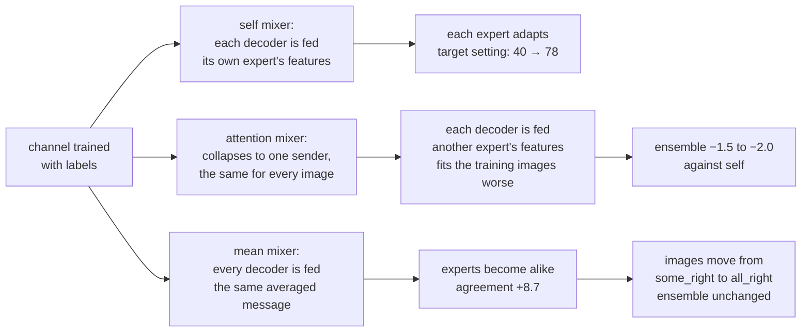

# Study: experts from different datasets

**Question.** When each expert is trained on a different digit dataset, does
a trained channel between them classify a dataset none of them saw better
than the same experts without communication?

The design and the commands are in the study's
[README](../../studies/multiple_datasets/README.md). This page reports the
third pass (`pass=3`), the only complete one.

## Background

In every earlier study the experts were trained on the same dataset and
differed by seed or class mix. Communication added nothing measurable over
the `self` control there ([QK-norm study](rmsnorm-attention.md),
[individual-loss study](individual-loss.md)). One reason could be that such
experts know nearly the same things, so there is little to tell each other.
Here each expert knows one dataset, and the ensemble is tested on a fourth
that none of them was trained on.

### The datasets

| role | dataset | images | native shape |
|---|---|---|---|
| expert 0 | MNIST | clean handwritten digits | 1×28×28 |
| expert 1 | SVHN | house numbers in street photographs | 3×32×32 |
| expert 2 | USPS | scanned postal digits | 1×16×16 |
| target | MNIST-M | MNIST digits over patches of colour photographs | 3×32×32 |

Every image is brought to 3×32×32. Each dataset's training set is split per
class into three parts that share no image, and its official test set is kept
apart:

| part | share | used for |
|---|---|---|
| expert | 50% | training that dataset's expert |
| joint | 40% | training the channel |
| joint_val | 10% | picking the epochs a run is read at |

### The experts

Expert *i* is a `cnn3` network trained only on dataset *i*, for 10 epochs,
then frozen. The cap was 10,000 images per expert:

| expert | training images |
|---|---|
| MNIST expert | 10,000 |
| SVHN expert | 10,000 |
| USPS expert | 3,645, all of USPS's expert part |

### The channel

An exchange reads every expert's features at one stage, mixes them across
experts, and writes an injection back into every expert's features at another
stage ([Channel](../testbed/channel.md)). The encoder and decoder are
`linear_taper_gelu` in every arm. The channel is the only thing that trains.

### The grid

| axis | values |
|---|---|
| setting | target, source |
| loss | joint loss (`--loss ensemble`), individual loss (`--loss per_expert`) |
| exchange direction | forward (`stage1 → stage2`), backward (`stage2 → stage1`, one round) |
| mixer | `attention`, `rmsnorm_attention`, `self`, `mean` |
| trial seeds | 0 to 4, so n = 5 per arm |

| setting | images the channel trains on |
|---|---|
| target setting | 8,700 MNIST-M images |
| source setting | 2,900 images each from MNIST, SVHN and USPS; no MNIST-M image |

In both settings joint_val and the test set are MNIST-M's, and the channel
trains for 30 epochs.

| loss | what is scored |
|---|---|
| joint loss | the negative log-likelihood of the ensemble's averaged probabilities |
| individual loss | the mean of the experts' own cross-entropies |

| mixer | what each receiver hears |
|---|---|
| `attention` | a weighted average of every expert's message, weighted by attention |
| `rmsnorm_attention` | the same, with the query and key normalised first |
| `self` | only its own message: the control with no communication |
| `mean` | the plain average of every expert's message |

The `self` mixer keeps the whole channel. Each expert still has an encoder
that reads its own features and a decoder that writes into its own features,
and both are trained. Only the exchange between experts is removed.

### The references

| reference | what it is |
|---|---|
| bagging | the plain average of the frozen experts' probabilities, with no channel. It is step 0 of every run |
| best single expert | per seed, the most accurate of the three frozen experts on MNIST-M. It is the MNIST expert on every seed |
| pooled model | one `cnn3` network trained on the 23,645 images the three experts were trained on |
| MoE | the soft-gated mixture of experts ([MoE](../testbed/moe.md)): a trained gate weighs the frozen experts' answers. It is trained once in each setting, on the same images as the channel |

A trial seed gives the same three experts to every arm, so arms are compared
seed by seed. Bagging itself moves by 7.5 points between seeds (36.04, 41.76,
38.83, 40.23, 43.56), and the paired comparison removes that spread.

## Hypotheses

- **H1, target setting.** Trained on MNIST-M images, a channel that
  communicates beats the `self` mixer on MNIST-M.
- **H2, source setting.** Trained only on source images, the channel still
  raises accuracy on MNIST-M over bagging, and a channel that communicates
  beats the `self` mixer.
- **H3, loss.** In the source setting the individual loss gives a larger lead
  over the `self` mixer than the joint loss.

A mixer's **lead over the `self` mixer** is its accuracy minus the accuracy
of the `self` mixer in the same setting, with the same loss, exchange
direction and seed. `attention`, `rmsnorm_attention` and `mean` are the three
**communicating mixers**.

## Results

Each trained run is one number: the median over the 5 trained epochs around
its best joint_val epoch. Values are test accuracy in points (×100), mean ± SE
over the 5 trial seeds. Every difference is paired by seed. "Pooled over
direction" averages each seed over the forward and backward exchange, then
takes the mean ± SE over seeds. With 5 seeds a paired difference has an SE of
0.2 to 0.65 points per cell, so differences of about 1 point are visible and
differences under about 0.5 are not.

### The experts alone

Test accuracy of the frozen models on each dataset's test set:

| model | MNIST-M | MNIST | SVHN | USPS |
|---|---|---|---|---|
| MNIST expert | 43.34 ± 1.23 | 97.72 ± 0.27 | 24.62 ± 1.93 | 70.82 ± 1.96 |
| SVHN expert | 34.70 ± 0.54 | 52.77 ± 0.47 | 82.84 ± 0.27 | 59.44 ± 0.56 |
| USPS expert | 17.32 ± 1.26 | 50.29 ± 3.86 | 15.21 ± 0.45 | 94.54 ± 0.18 |
| bagging | 40.08 ± 1.28 | 85.02 ± 0.74 | 54.34 ± 4.76 | 88.85 ± 0.54 |
| pooled model | 55.29 ± 0.81 | 97.91 ± 0.02 | 83.74 ± 0.17 | 94.83 ± 0.14 |
| pooled model − bagging | +15.20 ± 1.24 | +12.89 ± 0.73 | +29.39 ± 4.72 | +5.98 ± 0.55 |
| pooled model − that dataset's own expert | | +0.19 ± 0.27 | +0.90 ± 0.29 | +0.29 ± 0.23 |

- Each expert is accurate on its own dataset and poor elsewhere. The USPS
  expert is near chance on MNIST-M and SVHN.
- On MNIST-M, bagging is 3.25 ± 0.97 below the MNIST expert alone. The two
  weaker experts pull the average down.
- The pooled model matches each expert on that expert's own dataset and is 12
  points above the best expert on MNIST-M. It beats bagging on all four
  datasets.

### H2, first part: the channel raises accuracy in both settings

Test accuracy on MNIST-M:

| setting | loss | direction | `attention` | `rmsnorm_attention` | `self` | `mean` |
|---|---|---|---|---|---|---|
| target | joint loss | fwd | 76.21 ± 0.28 | 76.54 ± 0.18 | 77.47 ± 0.23 | 77.67 ± 0.33 |
| target | joint loss | bwd | 75.84 ± 0.46 | 77.64 ± 0.19 | 78.65 ± 0.32 | 78.60 ± 0.23 |
| target | individual loss | fwd | 78.32 ± 0.35 | 79.30 ± 0.21 | 79.50 ± 0.45 | 78.20 ± 0.31 |
| target | individual loss | bwd | 78.89 ± 0.49 | 79.40 ± 0.28 | 80.63 ± 0.22 | 79.97 ± 0.35 |
| source | joint loss | fwd | 52.39 ± 0.66 | 52.31 ± 0.63 | 52.61 ± 0.42 | 53.23 ± 0.16 |
| source | joint loss | bwd | 52.08 ± 0.38 | 53.03 ± 0.30 | 53.33 ± 0.38 | 53.42 ± 0.27 |
| source | individual loss | fwd | 53.80 ± 0.80 | 54.47 ± 0.41 | 54.14 ± 0.42 | 54.48 ± 0.46 |
| source | individual loss | bwd | 53.69 ± 0.53 | 54.71 ± 0.49 | 54.61 ± 0.43 | 54.96 ± 0.62 |

| reference | accuracy on MNIST-M |
|---|---|
| bagging | 40.08 ± 1.28 |
| best single expert | 43.34 ± 1.23 |
| pooled model | 55.29 ± 0.81 |
| MoE, target setting | 53.65 ± 0.86 |
| MoE, source setting | 48.84 ± 1.05 |

Channel minus each reference, pooled over direction:

| setting | loss | minus | `attention` | `rmsnorm_attention` | `self` | `mean` |
|---|---|---|---|---|---|---|
| target | joint loss | bagging | +35.94 ± 1.26 | +37.00 ± 1.34 | +37.97 ± 1.45 | +38.05 ± 1.29 |
| target | joint loss | MoE, target setting | +22.38 ± 0.94 | +23.44 ± 0.96 | +24.41 ± 0.99 | +24.49 ± 0.90 |
| target | individual loss | bagging | +38.52 ± 1.48 | +39.27 ± 1.31 | +39.98 ± 1.46 | +39.00 ± 1.45 |
| target | individual loss | MoE, target setting | +24.96 ± 1.16 | +25.71 ± 0.91 | +26.42 ± 0.99 | +25.44 ± 0.96 |
| source | joint loss | bagging | +12.15 ± 1.12 | +12.58 ± 1.32 | +12.89 ± 1.11 | +13.24 ± 1.26 |
| source | joint loss | best single expert | +8.90 ± 1.31 | +9.33 ± 1.38 | +9.64 ± 1.22 | +9.99 ± 1.30 |
| source | joint loss | MoE, source setting | +3.40 ± 0.89 | +3.83 ± 1.00 | +4.13 ± 0.92 | +4.49 ± 0.98 |
| source | joint loss | pooled model | −3.05 ± 0.77 | −2.62 ± 0.78 | −2.32 ± 0.70 | −1.97 ± 0.74 |
| source | individual loss | bagging | +13.66 ± 1.20 | +14.50 ± 1.19 | +14.29 ± 1.15 | +14.63 ± 1.15 |
| source | individual loss | best single expert | +10.41 ± 1.49 | +11.25 ± 1.31 | +11.04 ± 1.38 | +11.38 ± 1.43 |
| source | individual loss | MoE, source setting | +4.91 ± 0.88 | +5.75 ± 0.90 | +5.53 ± 0.89 | +5.88 ± 0.90 |
| source | individual loss | pooled model | −1.54 ± 0.56 | −0.70 ± 0.73 | −0.92 ± 0.48 | −0.57 ± 0.46 |

Target setting minus source setting, pooled over direction:

| loss | `attention` | `rmsnorm_attention` | `self` | `mean` |
|---|---|---|---|---|
| joint loss | +23.79 ± 0.37 | +24.42 ± 0.30 | +25.09 ± 0.49 | +24.81 ± 0.21 |
| individual loss | +24.86 ± 0.67 | +24.77 ± 0.25 | +25.69 ± 0.68 | +24.37 ± 0.59 |

The MoE in the target setting is 4.81 ± 0.51 above the MoE in the source
setting.

- Every channel arm beats bagging and the best single expert, in both
  settings, by 9 points or more.
- In the source setting the channel never sees an MNIST-M image and still
  gains 12 to 15 points over bagging on MNIST-M. It beats the MoE trained on
  the same images by 3.4 to 5.9 points, which is 3.5 to 6.5 SE in every cell.
- In the source setting the channel does not beat the pooled model. It is
  clearly below it with the joint loss, and within about 2 SE with the
  individual loss, except for the `attention` mixer.
- Training the channel on MNIST-M is worth about 25 points over training it
  on source images.

The first part of H2 is supported.

### H1 and H2, second part: communication does not beat the `self` mixer

Lead over the `self` mixer, per cell. In brackets: the number of seeds where
the `self` mixer is ahead.

| setting | loss | direction | `attention` | `rmsnorm_attention` | `mean` |
|---|---|---|---|---|---|
| target | joint loss | fwd | −1.26 ± 0.37 [5/5] | −0.93 ± 0.36 [5/5] | +0.20 ± 0.54 [2/5] |
| target | joint loss | bwd | −2.81 ± 0.65 [5/5] | −1.01 ± 0.28 [4/5] | −0.05 ± 0.26 [3/5] |
| target | individual loss | fwd | −1.18 ± 0.41 [5/5] | −0.20 ± 0.51 [3/5] | −1.30 ± 0.22 [5/5] |
| target | individual loss | bwd | −1.74 ± 0.62 [5/5] | −1.23 ± 0.36 [5/5] | −0.66 ± 0.32 [5/5] |
| source | joint loss | fwd | −0.22 ± 0.26 [3/5] | −0.30 ± 0.41 [3/5] | +0.62 ± 0.31 [1/5] |
| source | joint loss | bwd | −1.26 ± 0.36 [5/5] | −0.31 ± 0.55 [3/5] | +0.09 ± 0.55 [2/5] |
| source | individual loss | fwd | −0.34 ± 0.45 [3/5] | +0.33 ± 0.52 [2/5] | +0.34 ± 0.36 [2/5] |
| source | individual loss | bwd | −0.92 ± 0.18 [5/5] | +0.10 ± 0.33 [3/5] | +0.35 ± 0.36 [2/5] |

Pooled over direction:

| setting | loss | `attention` | `rmsnorm_attention` | `mean` |
|---|---|---|---|---|
| target | joint loss | −2.04 ± 0.36 | −0.97 ± 0.25 | +0.08 ± 0.38 |
| target | individual loss | −1.46 ± 0.49 | −0.72 ± 0.41 | −0.98 ± 0.25 |
| source | joint loss | −0.74 ± 0.27 | −0.30 ± 0.35 | +0.35 ± 0.24 |
| source | individual loss | −0.63 ± 0.27 | +0.21 ± 0.30 | +0.34 ± 0.11 |

Pooled over direction, loss and the three communicating mixers:

| setting | lead over the `self` mixer | per seed 0 to 4 |
|---|---|---|
| target | −1.02 ± 0.24 | −0.94, −1.33, −1.24, −1.44, −0.13 |
| source | −0.13 ± 0.18 | −0.07, −0.63, +0.42, −0.40, +0.05 |

- Of the 24 cells, 17 have a negative lead. Nine are negative beyond 2.78 SE,
  the 95% bound for 5 seeds. None is positive beyond 2 SE.
- The `self` mixer is ahead on all 5 seeds in 10 cells: every `attention`
  cell in the target setting, both `attention` backward cells in the source
  setting, and four more cells in the target setting.
- The `mean` mixer ties the `self` mixer with the joint loss in both
  settings. With the individual loss it is 0.98 ± 0.25 below in the target
  setting.
- The one positive pooled value beyond 2.78 SE is the `mean` mixer in the
  source setting with the individual loss, +0.34 ± 0.11. Both of its cells
  are within 1 SE of zero and it is one of 12 pooled tests, so it is not
  counted as real.
- In the first pass (3,600 expert images, 10 epochs) the `self` mixer beat
  every communicating mixer on all 5 seeds in the source setting with the
  joint loss and forward exchange. That does not hold here: in that cell it
  is ahead on 3, 3 and 1 of 5 seeds.

H1 is not supported, and it is reversed for the `attention` mixer. The
second part of H2 is not supported.

### H3: the individual loss is better, but not through communication

Accuracy in the source setting under each loss, pooled over direction:

| mixer | joint loss | individual loss | individual loss − joint loss |
|---|---|---|---|
| `attention` | 52.24 ± 0.48 | 53.75 ± 0.57 | +1.51 ± 0.37 |
| `rmsnorm_attention` | 52.67 ± 0.32 | 54.59 ± 0.35 | +1.92 ± 0.17 |
| `self` | 52.97 ± 0.27 | 54.37 ± 0.39 | +1.40 ± 0.32 |
| `mean` | 53.32 ± 0.19 | 54.72 ± 0.46 | +1.39 ± 0.32 |

The same in the target setting:

| mixer | joint loss | individual loss | individual loss − joint loss |
|---|---|---|---|
| `attention` | 76.02 ± 0.24 | 78.61 ± 0.37 | +2.59 ± 0.35 |
| `rmsnorm_attention` | 77.09 ± 0.13 | 79.35 ± 0.15 | +2.27 ± 0.11 |
| `self` | 78.06 ± 0.26 | 80.07 ± 0.29 | +2.01 ± 0.39 |
| `mean` | 78.13 ± 0.14 | 79.09 ± 0.20 | +0.95 ± 0.22 |

Change in the lead over the `self` mixer when the joint loss is replaced by
the individual loss, pooled over direction:

| setting | `attention` | `rmsnorm_attention` | `mean` |
|---|---|---|---|
| source | +0.11 ± 0.06 | +0.52 ± 0.42 | −0.01 ± 0.30 |
| target | +0.57 ± 0.56 | +0.26 ± 0.43 | −1.06 ± 0.48 |

- The individual loss gives a more accurate ensemble for every mixer in both
  settings, by 1.4 to 1.9 points in the source setting and 1.0 to 2.6 in the
  target setting. In the [individual-loss study](individual-loss.md), on
  experts from one dataset, the same effect was 0.1 to 0.2 points.
- The `self` mixer gains as much as the communicating mixers, so the lead
  does not grow. No change in the lead is beyond 2.2 SE.

H3 is not supported.

### Each expert after communication

Each expert's own test accuracy on MNIST-M at the picked epochs
(`test/expert_accuracy/expert{i}`), pooled over direction and the four
mixers. In brackets: the change from step 0.

| setting | loss | MNIST expert | SVHN expert | USPS expert |
|---|---|---|---|---|
| step 0 | | 43.34 ± 1.23 | 34.70 ± 0.54 | 17.32 ± 1.26 |
| target | joint loss | 71.37 (+28.03 ± 1.61) | 70.02 (+35.32 ± 0.99) | 54.60 (+37.28 ± 1.48) |
| target | individual loss | 76.15 (+32.82 ± 1.41) | 73.22 (+38.53 ± 0.98) | 65.20 (+47.89 ± 1.56) |
| source | joint loss | 50.29 (+6.95 ± 1.60) | 45.76 (+11.07 ± 0.47) | 34.61 (+17.30 ± 1.42) |
| source | individual loss | 52.17 (+8.83 ± 1.65) | 45.30 (+10.60 ± 0.52) | 37.44 (+20.12 ± 1.24) |

The same under the `self` mixer alone:

| setting | loss | MNIST expert | SVHN expert | USPS expert |
|---|---|---|---|---|
| target | joint loss | 71.29 (+27.95 ± 1.49) | 70.82 (+36.13 ± 0.95) | 50.68 (+33.36 ± 1.27) |
| target | individual loss | 75.95 (+32.62 ± 1.57) | 73.71 (+39.01 ± 0.92) | 62.33 (+45.01 ± 2.50) |
| source | joint loss | 49.10 (+5.77 ± 1.62) | 45.69 (+11.00 ± 0.96) | 35.64 (+18.33 ± 0.96) |
| source | individual loss | 51.56 (+8.22 ± 1.67) | 45.33 (+10.63 ± 0.68) | 37.91 (+20.59 ± 1.72) |

The three communicating mixers minus the `self` mixer:

| setting | loss | MNIST expert | SVHN expert | USPS expert |
|---|---|---|---|---|
| target | joint loss | +0.11 ± 0.62 | −1.07 ± 0.31 | +5.22 ± 0.75 |
| target | individual loss | +0.27 ± 0.37 | −0.64 ± 0.90 | +3.83 ± 1.60 |
| source | joint loss | +1.58 ± 0.35 | +0.09 ± 0.81 | −1.37 ± 0.99 |
| source | individual loss | +0.82 ± 0.49 | −0.04 ± 0.45 | −0.63 ± 0.78 |

- The channel improves all three experts in every setting and loss. The USPS
  expert gains the most and stays the weakest.
- Nearly all of each expert's gain is present under the `self` mixer.
- In the target setting, hearing the others adds about 5 points to the USPS
  expert. The ensemble is still about 1 point lower than under the `self`
  mixer.

### Why the `attention` mixer loses to the `self` mixer

Routing on joint_val at the picked epochs, mean over seeds:

| setting | loss | direction | mixer | `attn_top1` | `routing_mode_share/joint` | `route_flip_rate` | `self_attn_rate` | `routed_correct/all` |
|---|---|---|---|---|---|---|---|---|
| target | joint loss | fwd | `attention` | 1.00 | 1.00 | 0.00 | 0.07 | 0.30 |
| target | joint loss | fwd | `rmsnorm_attention` | 0.75 | 0.51 | 0.05 | 0.31 | 0.30 |
| target | joint loss | bwd | `attention` | 0.99 | 0.96 | 0.01 | 0.27 | 0.26 |
| target | joint loss | bwd | `rmsnorm_attention` | 0.65 | 0.28 | 0.07 | 0.35 | 0.30 |
| target | individual loss | fwd | `attention` | 1.00 | 1.00 | 0.00 | 0.20 | 0.33 |
| target | individual loss | fwd | `rmsnorm_attention` | 0.77 | 0.65 | 0.03 | 0.27 | 0.29 |
| target | individual loss | bwd | `attention` | 0.98 | 0.86 | 0.01 | 0.27 | 0.23 |
| target | individual loss | bwd | `rmsnorm_attention` | 0.68 | 0.47 | 0.04 | 0.36 | 0.34 |
| source | joint loss | fwd | `attention` | 1.00 | 0.69 | 0.04 | 0.34 | 0.31 |
| source | joint loss | fwd | `rmsnorm_attention` | 0.71 | 0.59 | 0.08 | 0.34 | 0.27 |
| source | joint loss | bwd | `attention` | 0.96 | 0.64 | 0.02 | 0.34 | 0.26 |
| source | joint loss | bwd | `rmsnorm_attention` | 0.65 | 0.32 | 0.13 | 0.35 | 0.28 |
| source | individual loss | fwd | `attention` | 1.00 | 0.83 | 0.03 | 0.15 | 0.29 |
| source | individual loss | fwd | `rmsnorm_attention` | 0.75 | 0.59 | 0.04 | 0.42 | 0.33 |
| source | individual loss | bwd | `attention` | 0.98 | 0.67 | 0.06 | 0.30 | 0.25 |
| source | individual loss | bwd | `rmsnorm_attention` | 0.71 | 0.58 | 0.05 | 0.37 | 0.29 |

| metric | what it measures |
|---|---|
| `attn_top1` | each receiver's largest attention weight: 1/3 is uniform, 1 is one sender |
| `routing_mode_share/joint` | share of images routed the most common way: 1 means routing ignores the image |
| `route_flip_rate` | share of (image, receiver) pairs whose most-heard sender changed since the previous epoch |
| `self_attn_rate` | how often a receiver's most-heard sender is itself |
| `routed_correct/all` | where a receiver heard another expert most, how often that expert was right before communication |

- The `attention` mixer collapses in every cell: each receiver puts all its
  weight on one sender. In the target setting that sender is the same for
  nearly every image, and it is usually another expert.
- `rmsnorm_attention` stays soft, at 0.65 to 0.77, as in the
  [QK-norm study](rmsnorm-attention.md).
- `routed_correct/all` is 0.23 to 0.34 for both mixers. The experts' average
  accuracy on MNIST-M before communication is 0.32. Receivers do not pick
  experts that are right more often than chance would.

Accuracy on each split, mixer minus the `self` mixer, pooled over direction.
`joint` is the split the channel trains on.

| setting | loss | split | `self` | `attention` − `self` | `rmsnorm_attention` − `self` | `mean` − `self` |
|---|---|---|---|---|---|---|
| target | joint loss | joint | 85.72 ± 0.59 | −3.89 ± 0.86 | −1.73 ± 0.49 | −0.82 ± 0.57 |
| target | joint loss | joint_val | 76.35 ± 0.24 | −1.75 ± 0.34 | −0.64 ± 0.20 | +0.31 ± 0.35 |
| target | joint loss | test | 78.06 ± 0.26 | −2.04 ± 0.36 | −0.97 ± 0.25 | +0.08 ± 0.38 |
| target | individual loss | joint | 87.23 ± 0.24 | −3.30 ± 0.74 | −1.29 ± 0.30 | −2.03 ± 0.40 |
| target | individual loss | joint_val | 78.77 ± 0.27 | −1.60 ± 0.38 | −0.87 ± 0.34 | −1.03 ± 0.33 |
| target | individual loss | test | 80.07 ± 0.29 | −1.46 ± 0.49 | −0.72 ± 0.41 | −0.98 ± 0.25 |
| source | joint loss | joint | 93.40 ± 0.25 | −1.19 ± 0.32 | −0.98 ± 0.72 | −0.99 ± 0.57 |
| source | joint loss | joint_val | 51.06 ± 0.38 | −0.59 ± 0.30 | −0.21 ± 0.25 | +0.43 ± 0.28 |
| source | joint loss | test | 52.97 ± 0.27 | −0.74 ± 0.27 | −0.30 ± 0.35 | +0.35 ± 0.24 |
| source | individual loss | joint | 93.69 ± 0.67 | −1.34 ± 0.38 | +0.06 ± 0.74 | −0.78 ± 0.65 |
| source | individual loss | joint_val | 53.08 ± 0.53 | −0.91 ± 0.24 | −0.02 ± 0.30 | +0.05 ± 0.17 |
| source | individual loss | test | 54.37 ± 0.39 | −0.63 ± 0.27 | +0.21 ± 0.30 | +0.34 ± 0.11 |

- The `attention` mixer is furthest behind on the images the channel trains
  on. Its deficit is in fitting, not in generalising.
- In the source setting every mixer reaches 92 to 94 on the source images it
  trains on and 50 to 55 on MNIST-M.

Injections and messages on joint_val, pooled over direction:

| setting | loss | metric | `attention` | `rmsnorm_attention` | `self` | `mean` |
|---|---|---|---|---|---|---|
| target | joint loss | `msg_norm/injection` | 137 ± 6 | 130 ± 8 | 130 ± 8 | 129 ± 7 |
| target | joint loss | `inj_spread` | 0.51 | 0.53 | 0.51 | 0.51 |
| target | joint loss | `msg_rank_value` | 1.93 | 2.10 | 2.57 | 2.19 |
| target | individual loss | `msg_norm/injection` | 214 ± 11 | 203 ± 10 | 194 ± 14 | 200 ± 9 |
| target | individual loss | `inj_spread` | 0.44 | 0.45 | 0.44 | 0.43 |
| target | individual loss | `msg_rank_value` | 1.91 | 2.02 | 2.41 | 2.14 |
| source | joint loss | `msg_norm/injection` | 64 ± 4 | 64 ± 7 | 67 ± 6 | 62 ± 7 |
| source | joint loss | `inj_spread` | 0.61 | 0.59 | 0.62 | 0.57 |
| source | joint loss | `msg_rank_value` | 1.79 | 1.97 | 2.36 | 2.18 |
| source | individual loss | `msg_norm/injection` | 102 ± 11 | 105 ± 6 | 106 ± 13 | 98 ± 6 |
| source | individual loss | `inj_spread` | 0.52 | 0.52 | 0.53 | 0.50 |
| source | individual loss | `msg_rank_value` | 1.57 | 1.96 | 1.98 | 2.05 |

| metric | what it measures |
|---|---|
| `msg_norm/injection` | average size of what the decoder adds to the receiving expert |
| `inj_spread` | share of the injection that differs between images: 0 is a constant shift |
| `msg_rank_value` | number of directions an expert's messages vary along, at most the width, 8 |

- The injection is as large and as image-dependent under the `self` mixer as
  under the communicating mixers. The `self` mixer's channel is doing as much
  to the experts.
- A message varies along about 2 directions out of a possible 8.
- Injections are about twice as large in the target setting as in the source
  setting, and about 50% larger with the individual loss than with the joint
  loss.

### Why the `mean` mixer does not beat the `self` mixer

`answer_grid` sorts each test image by how many of the 3 experts answer it
correctly, and whether the ensemble's averaged answer is correct. Agreement
is how often two experts give the same answer, averaged over pairs.

| cell | experts right | averaged answer |
|---|---|---|
| `all_right` | 3 | right |
| `some_right_avg_right` | 1 or 2 | right |
| `some_right_avg_wrong` | 1 or 2 | wrong: an expert knew it and the vote lost it |
| `none_right_avg_wrong` | 0 | wrong: no expert knew it |

On test, pooled over direction:

| setting | loss | metric | step 0 | `self` | `attention` − `self` | `rmsnorm_attention` − `self` | `mean` − `self` |
|---|---|---|---|---|---|---|---|
| target | joint loss | expert accuracy | 31.78 | 64.28 | −0.87 ± 0.54 | +0.97 ± 0.18 | +4.02 ± 0.43 |
| target | joint loss | agreement | 22.76 | 51.02 | +0.11 ± 0.84 | +2.81 ± 0.35 | +8.65 ± 0.86 |
| target | joint loss | `all_right` | 5.32 | 36.61 | +0.41 ± 0.97 | +2.70 ± 0.57 | +8.56 ± 0.98 |
| target | joint loss | `some_right_avg_right` | 34.69 | 41.14 | −2.06 ± 0.72 | −3.43 ± 0.76 | −8.36 ± 0.95 |
| target | joint loss | `some_right_avg_wrong` | 23.10 | 10.31 | +0.68 ± 0.13 | +0.44 ± 0.14 | −0.07 ± 0.15 |
| target | joint loss | `none_right_avg_wrong` | 36.82 | 11.67 | +1.25 ± 0.30 | +0.42 ± 0.20 | −0.09 ± 0.25 |
| target | individual loss | expert accuracy | 31.78 | 70.60 | −0.66 ± 0.97 | +1.43 ± 0.87 | +2.77 ± 0.62 |
| target | individual loss | agreement | 22.76 | 63.54 | +0.67 ± 1.41 | +4.42 ± 1.43 | +8.22 ± 1.31 |
| target | individual loss | `all_right` | 5.32 | 50.78 | +0.19 ± 1.73 | +4.03 ± 1.57 | +7.11 ± 1.55 |
| target | individual loss | `some_right_avg_right` | 34.69 | 29.18 | −1.69 ± 1.30 | −4.66 ± 1.25 | −8.08 ± 1.39 |
| target | individual loss | `some_right_avg_wrong` | 23.10 | 8.38 | +0.27 ± 0.16 | +0.08 ± 0.14 | −0.38 ± 0.17 |
| target | individual loss | `none_right_avg_wrong` | 36.82 | 11.56 | +1.26 ± 0.37 | +0.66 ± 0.32 | +1.40 ± 0.08 |
| source | joint loss | expert accuracy | 31.78 | 43.47 | −0.52 ± 0.47 | −0.01 ± 0.39 | +0.91 ± 0.68 |
| source | joint loss | agreement | 22.76 | 34.71 | −0.36 ± 0.96 | +0.73 ± 0.92 | +2.62 ± 1.78 |
| source | joint loss | `all_right` | 5.32 | 19.26 | −0.59 ± 0.69 | +0.11 ± 0.72 | +1.63 ± 1.32 |
| source | joint loss | `some_right_avg_right` | 34.69 | 33.69 | −0.29 ± 0.50 | −0.46 ± 0.84 | −1.36 ± 1.17 |
| source | joint loss | `some_right_avg_wrong` | 23.10 | 16.60 | +0.71 ± 0.22 | −0.20 ± 0.32 | −0.28 ± 0.31 |
| source | joint loss | `none_right_avg_wrong` | 36.82 | 30.41 | +0.16 ± 0.33 | +0.34 ± 0.19 | −0.06 ± 0.20 |
| source | individual loss | expert accuracy | 31.78 | 44.82 | −0.90 ± 0.19 | +0.29 ± 0.24 | +0.89 ± 0.45 |
| source | individual loss | agreement | 22.76 | 38.95 | −1.53 ± 0.52 | +0.53 ± 0.46 | +2.45 ± 0.97 |
| source | individual loss | `all_right` | 5.32 | 21.51 | −1.48 ± 0.38 | +0.42 ± 0.46 | +1.77 ± 0.68 |
| source | individual loss | `some_right_avg_right` | 34.69 | 32.64 | +0.99 ± 0.37 | −0.24 ± 0.58 | −1.25 ± 0.63 |
| source | individual loss | `some_right_avg_wrong` | 23.10 | 15.41 | +0.40 ± 0.28 | −0.25 ± 0.17 | −0.75 ± 0.13 |
| source | individual loss | `none_right_avg_wrong` | 36.82 | 30.08 | +0.26 ± 0.28 | +0.20 ± 0.20 | +0.45 ± 0.18 |

- In the target setting the `mean` mixer raises the experts' own accuracy by
  2.8 to 4.0 points over the `self` mixer and their agreement by more than 8.
  The USPS expert carries most of it: 60.3 against 50.7 with the joint loss.
- About 8 points move from `some_right_avg_right` to `all_right`. The
  ensemble already answered those images correctly, so its accuracy does not
  change.
- With the joint loss the two error cells do not move. With the individual
  loss `none_right_avg_wrong` grows by 1.40 ± 0.08, and the ensemble falls
  0.98 ± 0.25 below the `self` mixer.
- In the source setting the same moves are about a quarter of the size and
  mostly within 2 SE.
- Against step 0, the channel in the target setting empties both error
  cells: `none_right_avg_wrong` falls from 36.8 to about 12. In the source
  setting it falls only to about 30, so most images that no expert knew stay
  unknown.

### Did training finish

| runs | count | best joint_val epoch is epoch 30 | 5-epoch window reaches epoch 30 | median best epoch |
|---|---|---|---|---|
| channel, target setting | 80 | 14 | 33 | 26 to 28 |
| channel, source setting | 80 | 5 | 6 | 7 to 17 |
| MoE, both settings | 10 | 1 | 3 | 14 to 19 |

Test accuracy by epoch, mean over seeds and direction, joint loss /
individual loss:

| setting | mixer | epoch 1 | epoch 5 | epoch 10 | epoch 15 | epoch 20 | epoch 25 | epoch 30 |
|---|---|---|---|---|---|---|---|---|
| target | `attention` | 59.7 / 62.6 | 69.7 / 72.1 | 73.5 / 75.6 | 74.3 / 77.2 | 75.6 / 78.1 | 76.0 / 78.7 | 76.0 / 78.7 |
| target | `rmsnorm_attention` | 59.7 / 63.2 | 69.7 / 73.1 | 73.9 / 76.4 | 75.5 / 77.9 | 76.3 / 79.0 | 77.1 / 79.6 | 77.2 / 79.4 |
| target | `self` | 60.2 / 63.6 | 70.4 / 73.6 | 74.5 / 76.7 | 76.1 / 78.6 | 76.9 / 79.3 | 77.5 / 80.2 | 78.3 / 80.3 |
| target | `mean` | 59.6 / 62.6 | 69.7 / 73.0 | 74.3 / 76.4 | 76.3 / 77.7 | 77.3 / 78.5 | 77.9 / 79.5 | 78.5 / 79.1 |
| target | MoE | 51.9 | 53.2 | 53.3 | 53.7 | 53.4 | 53.8 | 53.6 |
| source | `attention` | 48.8 / 52.4 | 51.7 / 53.9 | 52.0 / 53.4 | 52.2 / 53.1 | 51.4 / 53.1 | 51.6 / 52.6 | 51.6 / 53.1 |
| source | `rmsnorm_attention` | 49.1 / 52.9 | 51.9 / 54.2 | 52.3 / 54.2 | 52.7 / 54.0 | 51.4 / 53.4 | 51.4 / 53.3 | 51.5 / 53.2 |
| source | `self` | 49.5 / 53.4 | 52.1 / 54.7 | 52.9 / 54.4 | 53.1 / 53.9 | 52.7 / 53.6 | 52.5 / 53.3 | 52.7 / 54.0 |
| source | `mean` | 49.3 / 53.1 | 52.9 / 55.0 | 52.5 / 54.2 | 52.9 / 54.4 | 52.0 / 53.7 | 52.5 / 53.3 | 52.0 / 53.1 |
| source | MoE | 46.9 | 47.8 | 47.3 | 47.9 | 48.1 | 48.7 | 49.3 |

Step 0 is 40.1 in every row.

Picked score minus the last epoch's test accuracy, pooled over direction and
mixer:

| setting | loss | picked − last epoch |
|---|---|---|
| target | joint loss | −0.16 ± 0.13 |
| target | individual loss | −0.11 ± 0.26 |
| source | joint loss | +0.84 ± 0.25 |
| source | individual loss | +0.99 ± 0.35 |

- 20 of the 170 trained runs have their best joint_val epoch at the last
  epoch.
- In the target setting training has not fully converged. Test accuracy
  still rises by up to 0.8 points between epochs 25 and 30, most for the
  `self` and `mean` mixers with the joint loss.
- In the source setting test accuracy peaks between epochs 5 and 15 and then
  falls by about 1 point. The picked score is about 0.9 above the last
  epoch, and the pick uses MNIST-M labels.

## Explanation

**The `self` mixer trains a path of its own.** Under the `self` mixer each
expert's encoder reads that expert's features and its decoder writes into
them, so each expert gets a small trainable add-on from its read point to its
write point. The channel is trained with labels, on MNIST-M in the target
setting. That is adaptation of each expert to the new images, and it needs no
message from another expert.

**What the data shows fits this.**
- The injection is as large and as image-dependent under the `self` mixer as
  under any other mixer, and nearly all of each expert's own gain is present
  under the `self` mixer.
- The MoE, which can only reweigh the frozen experts' answers, gains 9 to 14
  points. The channel, which changes the experts' features, gains 12 to 40.
- The `attention` mixer's routing is fixed, ignores the image, and picks a
  correct expert no more often than chance. It behaves like the `self` mixer
  with the wires crossed, and it fits the channel's own training images
  worse: by 3 to 4 points in the target setting and about 1 in the source
  setting.
- The `mean` mixer does transfer something: the USPS expert is 10 points
  better with it than under the `self` mixer in the target setting. But the
  ensemble already averages the experts' answers, so an image one expert
  learns from the others is usually one the vote already got right.

**Why the source setting gains less.** The channel trains on images where one
expert was trained on that image's dataset. It reaches 92 to 94 on those
images and 50 to 55 on MNIST-M, and `none_right_avg_wrong` on MNIST-M falls
only from 36.8 to about 30. What it learns on source images transfers to
MNIST-M only in part, and it begins to over-fit the source images after
about 10 epochs.

**Why the pooled model is the reference to beat.** It is one network of an
expert's size trained on the same 23,645 images, and it scores 55.3 on
MNIST-M with no channel and no joint split. In the source setting the three
experts plus a channel, using 8,700 more labelled source images, reach 52 to
55.

The first paragraph follows from how the channel is built. The rest is a
reading of the metrics, and it was not tested by an intervention. Two direct
checks: evaluate a trained `attention` channel with its routing forced to
`self`, and widen the channel to see whether the 2 directions a message uses
are the limit.

**Conclusion.** A channel trained on top of three experts from different
datasets raises their accuracy on a dataset none of them saw, by about 38
points when it is trained on that dataset and by 12 to 15 when it is trained
only on the experts' own datasets. It beats bagging, the best single expert
and the soft-gated MoE in both settings. It does not beat one model trained
on the experts' pooled images unless it is trained on the target dataset. The
gain does not come from communication: the `self` mixer, where each expert
hears only itself, is as good as or better than every communicating mixer.
The `attention` mixer collapses to a fixed wiring and is 0.6 to 2.0 points
worse. The `mean` mixer makes the experts more alike without making the
ensemble more accurate. The individual loss adds 1 to 2.6 points for every
mixer, the `self` mixer included.

## Caveats

- n = 5. A paired difference of about 1 point is visible; differences under
  about 0.5 are not. The order of the `rmsnorm_attention`, `mean` and `self`
  mixers in the source setting is not resolved.
- The lead tables hold 24 per-cell tests and 12 pooled tests. A single value
  near 3 SE can be chance.
- In the source setting the epochs a run is read at are picked on MNIST-M's
  joint_val, so the score uses target labels. It is about 0.9 points above
  the last epoch. Bagging and the pooled model have no such pick.
- In the target setting training had not converged at 30 epochs.
- The channel trains on 8,700 labelled images that the pooled model never
  sees. The pooled model is a reference, not a like-for-like baseline.
- The baseline is the soft-gated MoE, not the feature combiner of the plan.
- The home expert is not masked. In the source setting the channel can do
  well on its training images by relying on the expert that knows the image's
  dataset.
- MNIST-M is built from MNIST digits, so the MNIST expert has seen its shapes.
- The USPS expert trained on 3,645 images against 10,000 for the others, and
  USPS is upscaled from 16×16.
- The pooled model's runs on MNIST, SVHN and USPS were added after the main
  job, with the same command and one flag changed. Their weights digests
  match the original pooled runs.

## Next

- Evaluate trained `attention` channels with routing forced to `self`, to
  test the crossed-wires reading directly.
- A wider channel, since messages use about 2 of 8 directions.
- Early stopping on a source joint_val in the source setting, so no target
  label is used.
- Masking the home expert in the source setting.
- The feature-combiner baseline, and a pooled model that also trains on the
  joint split.
- More joint epochs in the target setting.

## Details

- MLflow: experiment `v3`, tracking URI `sqlite:///<repo root>/mlflow.db`.
  Tags `study=multiple-datasets` and `pass=3`: 210 runs over 42 arms.
- Arms: `experts-on-{mnist_m, mnist, svhn, usps}`, `pooled`,
  `pooled-on-{mnist, svhn, usps}`, `{setting}-moe`,
  `{setting}-{loss}-{fwd,bwd}-{mixer}` with loss `ensemble` or `per_expert`.
  Run name `{arm}-trial{seed}`.
- The main job: `uv run python -m studies.multiple_datasets.run
  --expert-samples 10000 --tag pass=3`. `run.py` does not build the three
  `pooled-on-*` arms.
- Every table on this page is printed by
  `uv run python -m studies.multiple_datasets.analyse`.
- Checks made before reading the results: all runs finished, 30 joint epochs
  and an expert cap of 10,000 on every run, and one `pool.digest` per seed
  across all per-dataset arms and across all pooled arms.
- Runs to ignore in the same experiment: an untagged first pass (3,600 expert
  images, 10 epochs, not finished).
- Fixed: `cnn3` experts, M = 3, 10 expert epochs, width r = 8, d_k = 16,
  d_v = 64, learning rate 1e-3, batch 128, split seed 0.
- Run score (`testbed/results.py`): the median over the 5 trained epochs
  around the best joint_val epoch. Step 0 is never in the window. The MoE is
  scored the same way; bagging, the experts and the pooled model are read at
  step 0.
- Routing and message metrics are logged on joint_val per site: `ex0`
  forward, `ex0/round0` backward. The `self` and `mean` mixers log no routing
  metric.
