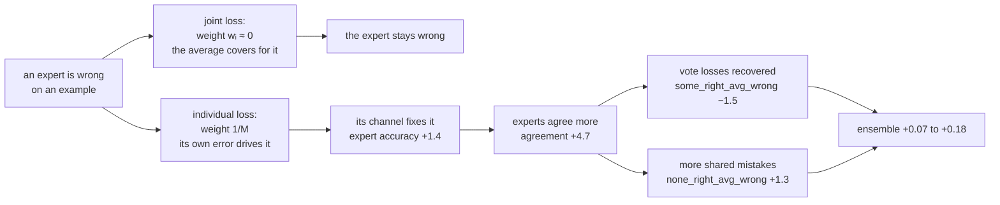

# Study: joint loss vs individual loss

**Question.** Does training the channel on each expert's own loss, instead of
the ensemble's, give a more accurate ensemble, and does it make communication
help more?

Part of the [channel ladder](channel-ladder.md); the docket left the
individual loss as a separate study (2026-10-25).

## Background

The channel sits on top of frozen experts and is the only thing that trains,
so the loss decides what each expert's channel is pushed to fix. Until now
every run used the joint loss, which scores only the ensemble's averaged
answer. Under it, an expert can stay wrong on an example as long as the
average is right. The individual loss scores each expert's own answer, so
every expert has to be right itself.

Communication so far has added nothing measurable over the `self` control,
where each expert hears only its own message ([QK-norm
study](rmsnorm-attention.md)). One reason could be the loss: if an expert is
never pushed to fix its own mistakes, it has no reason to use what the others
tell it.

### The grid

The same grid as the QK-norm study, run once with each loss:

| axis | values |
|---|---|
| loss | joint (`--loss ensemble`), individual (`--loss per_expert`) |
| direction | forward (`stage1 → stage2`), backward (`stage2 → stage1`, one round) |
| level | `1`: `linear_taper` encoder and decoder; `3`: `linear_taper_gelu` both, a GELU in each |
| mixer | `attention`, `rmsnorm_attention`, `self`, `mean` |
| trial seeds | 0–4, so n = 5 per arm |

| mixer | what each receiver hears |
|---|---|
| `attention` | a weighted average of every expert's message, weighted by attention |
| `rmsnorm_attention` | the same, with the query and key normalised first |
| `self` | only its own message: the control with no communication |
| `mean` | the plain average of every expert's message |

A pair of runs at the same arm and trial seed differs only in the loss, with
the same experts and seeds, so the losses are compared seed by seed.

### The two losses

```
joint:       L = −log( (1/M) Σⱼ pⱼ[y] )
individual:  L = (1/M) Σᵢ −log pᵢ[y]
```

| symbol | meaning |
|---|---|
| M | number of experts, 3 |
| y | the true class |
| pᵢ | expert i's probabilities over the classes, after communication |
| pᵢ[y] | expert i's probability on the true class |
| (1/M) Σⱼ pⱼ[y] | the ensemble's averaged probability on the true class |

The joint loss is low whenever the average puts enough probability on the
true class, whichever expert supplies it. The individual loss is low only if
every expert does.

### The shared baseline

Bagging, the plain average of the frozen experts before any communication, is
every run's step 0. The experts are the same under both losses, so bagging is
identical for a given seed, which makes it a baseline shared by all 32
configurations. Bagging itself moves by 7.5 points between seeds (88.50,
89.61, 89.66, 88.09, 82.13), so configurations are compared with each other,
paired by seed, where that spread cancels.

## Hypotheses

- **H1, accuracy.** The individual loss gives a more accurate ensemble than
  the joint loss.
- **H2, communication.** Communication helps more under the individual loss.
  Under the joint loss an expert can stay wrong as long as the average is
  right; under the individual loss each expert has to be right itself, so it
  has more reason to use the others' messages.

H2 is measured as a mixer's **lead over `self`**: its accuracy minus the
accuracy of `self` trained with the same loss on the same seed. `self` keeps
the whole channel but each expert hears only its own message, so the lead is
what hearing the others adds. H2 predicts the lead is larger under the
individual loss.

## Results

Each value is the run's number, then the mean ± SE over the 5 trial seeds, in
accuracy points (×100). "Pooled" averages each seed over the four direction ×
level settings, then takes the mean ± SE over seeds. With 5 seeds,
differences smaller than about ±0.2 points cannot be resolved.

### H1: the individual loss gives a more accurate ensemble

Gain over bagging on test, pooled:

| mixer | joint | individual | individual − joint, paired |
|---|---|---|---|
| attention | +2.58 | +2.68 | +0.10 ± 0.03 |
| rmsnorm_attention | +2.61 | +2.78 | +0.17 ± 0.06 |
| self | +2.59 | +2.76 | +0.18 ± 0.03 |
| mean | +2.68 | +2.75 | +0.07 ± 0.05 |

Each gain over bagging has an SE of about ±1.25, which is bagging's own seed
spread. The paired difference in the last column removes it.

Test accuracy per arm:

| setting | mixer | joint | individual | individual − joint |
|---|---|---|---|---|
| fwd 1 | attention | 90.18 ± 0.12 | 90.24 ± 0.15 | +0.06 ± 0.04 |
| fwd 1 | rmsnorm_attention | 90.27 ± 0.14 | 90.35 ± 0.13 | +0.08 ± 0.07 |
| fwd 1 | self | 90.18 ± 0.13 | 90.43 ± 0.13 | +0.26 ± 0.04 |
| fwd 1 | mean | 90.29 ± 0.16 | 90.27 ± 0.13 | −0.02 ± 0.06 |
| fwd 3 | attention | 90.16 ± 0.14 | 90.22 ± 0.19 | +0.06 ± 0.06 |
| fwd 3 | rmsnorm_attention | 90.14 ± 0.17 | 90.30 ± 0.17 | +0.16 ± 0.07 |
| fwd 3 | self | 90.17 ± 0.17 | 90.32 ± 0.15 | +0.15 ± 0.04 |
| fwd 3 | mean | 90.20 ± 0.15 | 90.28 ± 0.19 | +0.08 ± 0.06 |
| bwd 1 | attention | 90.16 ± 0.18 | 90.37 ± 0.19 | +0.21 ± 0.05 |
| bwd 1 | rmsnorm_attention | 90.25 ± 0.16 | 90.50 ± 0.13 | +0.25 ± 0.08 |
| bwd 1 | self | 90.26 ± 0.18 | 90.40 ± 0.17 | +0.13 ± 0.03 |
| bwd 1 | mean | 90.36 ± 0.18 | 90.50 ± 0.13 | +0.14 ± 0.08 |
| bwd 3 | attention | 90.21 ± 0.18 | 90.29 ± 0.21 | +0.08 ± 0.05 |
| bwd 3 | rmsnorm_attention | 90.17 ± 0.23 | 90.38 ± 0.16 | +0.21 ± 0.11 |
| bwd 3 | self | 90.12 ± 0.22 | 90.29 ± 0.20 | +0.17 ± 0.07 |
| bwd 3 | mean | 90.26 ± 0.17 | 90.32 ± 0.21 | +0.06 ± 0.07 |

The best configurations of all 32, by gain over bagging on test:

| rank | loss | setting | mixer | gain |
|---|---|---|---|---|
| 1 | individual | bwd 1 | mean | +2.91 |
| 2 | individual | bwd 1 | rmsnorm_attention | +2.90 |
| 3 | individual | fwd 1 | self | +2.84 |
| 4 | individual | bwd 1 | self | +2.80 |
| 5 | individual | bwd 3 | rmsnorm_attention | +2.78 |
| 6 | individual | bwd 1 | attention | +2.77 |
| 7 | joint | bwd 1 | mean | +2.77 |
| 8 | individual | fwd 1 | rmsnorm_attention | +2.75 |

- 15 of 16 arms score higher with the individual loss on test, and all 16 on
  joint_val (+0.05 to +0.23), which picks the epochs.
- 13 of the 16 best configurations use the individual loss.
- The best few are within 0.1 points of each other, closer than 5 seeds can
  separate.

H1 is supported: the gain is small, about 0.1–0.2 points, but consistent.

### H2: communication does not help more

Lead over `self`, test, pooled:

| mixer | joint | individual | individual − joint |
|---|---|---|---|
| attention | −0.01 ± 0.05 | −0.08 ± 0.05 | −0.07 ± 0.05 |
| rmsnorm_attention | +0.02 ± 0.01 | +0.02 ± 0.05 | 0.00 ± 0.06 |
| mean | +0.09 ± 0.03 | −0.02 ± 0.05 | −0.11 ± 0.06 |

Individual − joint on the lead, per setting:

| setting | attention | rmsnorm_attention | mean |
|---|---|---|---|
| fwd 1 | −0.20 ± 0.07 | −0.18 ± 0.11 | −0.28 ± 0.09 |
| fwd 3 | −0.08 ± 0.08 | +0.02 ± 0.08 | −0.06 ± 0.08 |
| bwd 1 | +0.07 ± 0.07 | +0.12 ± 0.08 | +0.01 ± 0.09 |
| bwd 3 | −0.09 ± 0.08 | +0.04 ± 0.11 | −0.11 ± 0.11 |

- No pooled value is positive: `self` gains as much from the individual loss
  as the mixers that hear the others, so the lead does not grow.
- The one consistent pattern runs the other way, in fwd 1, where `self`
  gains the most (+0.26 ± 0.04). bwd 1 leans toward H2, under 1.5 SE.
- The same test on the experts' own accuracy is near 0 for every mixer.

H2 is not supported. The individual loss is better, but not through
communication.

### What changes inside the ensemble

`answer_grid` sorts each test example by how many of the M = 3 experts answer
it correctly (k), and whether the ensemble's averaged answer is correct. The
cells sum to 1.

| cell | k | averaged answer |
|---|---|---|
| `all_right` | 3 | right |
| `some_right_avg_right` | 1 or 2 | right |
| `some_right_avg_wrong` | 1 or 2 | wrong: an expert knew it and the vote lost it |
| `none_right_avg_wrong` | 0 | wrong: no expert knew it |

| cell | step 0 (bagging) | joint, range over 16 arms | individual, range over 16 arms |
|---|---|---|---|
| `all_right` | 69.06 | 78.6–79.8 | 83.8–84.9 |
| `some_right_avg_right` | 18.53 | 10.5–11.6 | 5.6–6.5 |
| `some_right_avg_wrong` | 7.87 | 4.75–5.12 | 3.28–3.63 |
| `none_right_avg_wrong` | 4.54 | 4.68–4.96 | 5.93–6.29 |

Individual − joint on test, pooled:

| metric | attention | rmsnorm_attention | self | mean |
|---|---|---|---|---|
| `expert_accuracy` | +1.45 ± 0.44 | +1.41 ± 0.51 | +1.44 ± 0.43 | +1.33 ± 0.49 |
| `agreement_post` | +4.76 ± 1.13 | +4.65 ± 1.29 | +4.74 ± 1.17 | +4.68 ± 1.30 |
| `all_right` | +5.27 ± 1.45 | +5.16 ± 1.65 | +5.28 ± 1.48 | +5.08 ± 1.65 |
| `some_right_avg_right` | −5.15 ± 1.47 | −4.98 ± 1.64 | −5.09 ± 1.46 | −4.96 ± 1.67 |
| `some_right_avg_wrong` | −1.45 ± 0.15 | −1.49 ± 0.21 | −1.47 ± 0.23 | −1.48 ± 0.19 |
| `none_right_avg_wrong` | +1.32 ± 0.19 | +1.31 ± 0.20 | +1.30 ± 0.21 | +1.41 ± 0.22 |
| `corrected` | +0.25 ± 0.06 | +0.24 ± 0.03 | +0.20 ± 0.03 | +0.14 ± 0.05 |
| `corrupted` | +0.13 ± 0.05 | +0.10 ± 0.04 | +0.06 ± 0.03 | +0.09 ± 0.09 |

| metric | what it measures |
|---|---|
| `expert_accuracy` | share of the experts' own answers that are right, after communication |
| `agreement_post` | how often two experts give the same answer, averaged over pairs |
| `corrected` | share of the ensemble's answers turned wrong → right, relative to bagging |
| `corrupted` | share turned right → wrong |

- The individual loss raises each expert's own accuracy by about 1.4 points
  and makes the experts agree about 4.7 points more, in every mixer.
- The interaction with communication is flat here too: for every mixer, the
  individual − joint change in `some_right_avg_wrong`, `none_right_avg_wrong`,
  `corrected` and `corrupted` matches `self`'s within ±0.12.
- The seed spread of expert accuracy shrinks from ±0.6 to ±0.1–0.25. Seed 4,
  the weakest (bagging 82.1), gains 3.2–3.4 points of expert accuracy,
  against about 1 for the other seeds.

### Routing under each loss

Picked-window values, mean over seeds, joint / individual:

| setting | mixer | `attn_top1` | `qk_cos_gap` | `routing_mode_share/joint` | `msg_norm/injection` |
|---|---|---|---|---|---|
| fwd 1 | attention | 1.00 / 1.00 | 0.87 / 0.92 | 0.82 / 0.92 | 13.1 / 19.1 |
| fwd 1 | rmsnorm | 0.63 / 0.65 | 0.45 / 0.53 | 0.33 / 0.36 | 12.7 / 17.8 |
| fwd 3 | attention | 0.98 / 1.00 | 0.76 / 0.73 | 0.80 / 0.95 | 13.2 / 19.4 |
| fwd 3 | rmsnorm | 0.64 / 0.64 | 0.50 / 0.53 | 0.59 / 0.43 | 12.0 / 17.1 |
| bwd 1 | attention | 0.99 / 0.99 | 0.82 / 0.81 | 0.66 / 0.98 | 14.5 / 21.8 |
| bwd 1 | rmsnorm | 0.65 / 0.61 | 0.50 / 0.46 | 0.50 / 0.30 | 14.5 / 18.8 |
| bwd 3 | attention | 0.92 / 0.99 | 0.73 / 0.73 | 0.91 / 0.95 | 12.2 / 19.1 |
| bwd 3 | rmsnorm | 0.64 / 0.65 | 0.48 / 0.52 | 0.42 / 0.52 | 12.5 / 18.8 |

| metric | what it measures |
|---|---|
| `attn_top1` | each receiver's largest attention weight: 1/3 is uniform, 1 is one sender |
| `qk_cos_gap` | how much more a receiver's query points at its best-matched key than its worst, by angle (0 to 2) |
| `routing_mode_share/joint` | share of examples routed the most common way: 1 means routing ignores the input |
| `msg_norm/injection` | average size of what the decoder adds to the receiving expert |

- Plain attention still collapses under the individual loss, and its routing
  becomes even more fixed: 0.92–0.98 of examples routed the same way.
- `rmsnorm_attention` stays soft under both losses; its routing changes
  within the seed spread.
- Injections are 30–55% larger under the individual loss in every arm: the
  decoders write more into each expert.

`routed_correct` asks, for the sender each receiver listened to most (itself
excluded), whether that sender was right before communication. On joint_val,
joint / individual:

| setting | mixer | `all` | `corrected` | `corrupted` |
|---|---|---|---|---|
| fwd 1 | attention | 82.1 / 83.4 | 72.5 / 72.5 | 48.4 / 37.8 |
| fwd 1 | rmsnorm | 83.5 / 83.6 | 73.7 / 75.1 | 49.1 / 42.4 |
| fwd 3 | attention | 83.8 / 83.8 | 70.1 / 72.2 | 48.7 / 38.0 |
| fwd 3 | rmsnorm | 83.8 / 84.5 | 69.5 / 72.8 | 48.0 / 36.5 |
| bwd 1 | attention | 84.6 / 86.9 | 70.7 / 72.1 | 54.3 / 47.3 |
| bwd 1 | rmsnorm | 83.2 / 83.3 | 64.7 / 74.1 | 51.5 / 40.9 |
| bwd 3 | attention | 84.5 / 84.6 | 74.3 / 70.6 | 46.7 / 40.8 |
| bwd 3 | rmsnorm | 84.7 / 84.0 | 72.1 / 70.8 | 43.7 / 40.7 |

| subset | which (example, receiver) pairs it counts |
|---|---|
| `all` | every pair where the receiver listened most to another expert |
| `corrected` | pairs where the receiver's own answer went from wrong to right |
| `corrupted` | pairs where the receiver's own answer went from right to wrong |

- `all` stays at 83–87 under both losses, about the experts' accuracy before
  communication (83.9): receivers pick a right expert about as often as
  chance.
- `corrupted` falls from 44–54 to 37–47 in every setting: under the
  individual loss, when a receiver goes from right to wrong, the expert it
  listened to was more often wrong.
- `corrected` barely moves, so routing does not pick right experts any better.

## Explanation

**The gradients.** Each loss sends this gradient to expert i's logits zᵢ:

```
joint:       ∂L/∂zᵢ = wᵢ · (pᵢ − onehot(y)),     wᵢ = pᵢ[y] / Σⱼ pⱼ[y]
individual:  ∂L/∂zᵢ = (1/M) · (pᵢ − onehot(y))
```

| symbol | meaning |
|---|---|
| zᵢ | expert i's logits |
| onehot(y) | 1 on the true class, 0 elsewhere |
| pᵢ − onehot(y) | expert i's error: large when it is wrong |
| wᵢ | expert i's share of the experts' total probability on the true class |

Under the joint loss each expert's error is scaled by wᵢ, its share of the
probability on the true class. An expert that is wrong has a small share and
gets almost no gradient, because the average is right without it. For example,
with pᵢ[y] = 0.05 and the other two at 0.9, wᵢ = 0.05 / 1.85 ≈ 0.03. Under
the individual loss every expert's error is scaled by 1/M, so the wrong expert
has the largest error and is pushed hardest.



**What the data shows fits this.**
- Each expert's own accuracy rises by 1.4 points under the individual loss:
  the wrong experts are now trained on their mistakes.
- The weakest experts gain the most (seed 4), and the experts' spread
  shrinks: weak experts are wrong most often, so they gain most from having
  their mistakes count.
- The decoders write 30–55% more into each expert: the channel is now pushed
  to change each expert's own answer.
- `self` gains as much as the mixers that communicate: the fix happens in
  each expert's own channel and does not need the others' messages. That is
  why H2 fails.

**Why only 0.1–0.2 points reach the ensemble.** The experts become more alike:
agreement rises 4.7 points. About 5 points move from `some_right_avg_right`
to `all_right`, which changes no answer of the ensemble's. 1.5 points leave
`some_right_avg_wrong`, examples the vote used to lose, but 1.3 join
`none_right_avg_wrong`, examples every expert now gets wrong together. The
joint loss tolerates disagreement as long as the average is right; the
individual loss pushes every expert toward the same answers, and some of
those are shared mistakes. The two moves nearly cancel.

The gradient argument follows from the two losses, and the data fits it, but
it was not measured directly. A direct check would log wᵢ under the joint
loss and show it near 0 on the examples expert i gets wrong.

**Conclusion.** The individual loss gives a more accurate ensemble, by about
0.1–0.2 points in every mixer. It does so by training each expert's channel to
fix that expert's own mistakes, which the joint loss leaves alone whenever the
average is right. That works without communication: `self` gains as much as
the mixers that hear the others, so communication's lead over `self` does not
grow. Most of the experts' own gain is lost to the ensemble because they
become more alike and start making the same mistakes.

## Caveats

- 10 joint epochs, not the docket's 30. Up to 4 of 5 seeds per arm had their
  best epoch at the last one.
- n = 5 resolves about ±0.2 points. The H2 tables hold 12 per-setting tests;
  the fwd 1 pattern is the most consistent but could still be chance.
- joint beat joint_val by 0.98–1.80 points under the individual loss, against
  0.69–1.59 under the joint loss: a little more overfitting.

## Next

- 30 epochs and 15 trial seeds on the best few: the individual loss with
  `rmsnorm_attention`, `mean` and `self`, backward level 1.
- Log the joint loss's per-expert gradient weight wᵢ to test the mechanism
  directly.
- Joint and individual losses added together (the docket's other option), to
  keep the experts' own gain without losing as much diversity.

## Details

- MLflow: experiment `v3`, tracking URI `sqlite:///<repo root>/mlflow.db`.
- The two losses share arm names and tags; tell them apart by the param
  `joint.loss` (`ensemble` or `per_expert`).
- Tags: `study=channel-ladder`, `level` (`1`, `3`), `mixer`, `direction`
  (`forward`, `backward`), `trial_seed`, `arm` = `{fwd,bwd}-{level}-{mixer}`.
  Run name `{arm}-trial{seed}`.
- Fixed: `cnn3` experts, M = 3, class skew α = 1, dataset `fashion`,
  width r = 8, d_k = 16, d_v = 64, learning rate 1e-3, batch 128,
  10 joint epochs.
- Run score (`testbed/results.py`): the median over the 5 trained epochs
  around the best joint_val epoch. Step 0 is never in the window.
- Each run logs its own loss as `{split}/loss`, so loss values are not
  comparable between the two losses; compare by accuracy.
- Training is deterministic: rerunning an arm and seed reproduces its test
  accuracy exactly.
- Routing metrics are logged on joint_val per site: `ex0` forward,
  `ex0/round0` backward. `self` and `mean` log none.
- Two runs logged no `routed_correct` `corrected` or `corrupted` value in
  their window (an empty subset): fwd 1 attention under the joint loss and
  bwd 1 attention under the individual loss. Those cells average the
  remaining 4 seeds.
