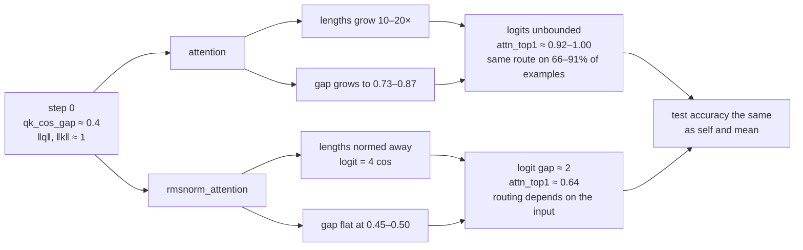

# Study: QK-norm in the channel's attention

**Question.** Does normalising the query and key stop the channel's attention
from collapsing, and does a channel whose attention does not collapse beat the
controls?

Part of the [channel ladder](channel-ladder.md); the decision to add the mixer
is in the [docket](../docket.md) (2026-11-06).

## Background

In the channel ladder each expert sends a message, and an attention mixer
decides how much each receiving expert listens to each sender. Two problems
led to this study:

- **The queries and keys grew in norm every epoch.** The attention logit is
  their dot product, so growing lengths make the softmax sharper and sharper,
  until each receiver listens to a single sender.
- **Attention added nothing over its `self` control.** In the pilot (trial
  seeds 0–9, level 1), attention − `self` was −0.05 ± 0.15 points forward and
  −0.09 ± 0.16 backward. `self` keeps the whole channel but each expert hears
  only its own message, so attention was not getting anything out of hearing
  the others.

If the collapse is what stops attention from using the others' messages,
removing it should help. QK-norm is the standard way to remove it: normalise
the query and key before the dot product, so their lengths cannot change the
attention.

### The grid

| axis | values |
|---|---|
| direction | forward (`stage1 → stage2`), backward (`stage2 → stage1`, one round) |
| level | `1`: `linear_taper` encoder and decoder; `3`: `linear_taper_gelu` both, a GELU in each |
| mixer | `attention`, `rmsnorm_attention`, `self`, `mean` |
| trial seeds | 0–4, so n = 5 per arm |

Within a direction and level the arms differ only in the mixer, and a trial
seed gives the same experts to every arm, so arms are compared seed by seed.

| mixer | what each receiver hears |
|---|---|
| `attention` | a weighted average of every expert's message, weighted by attention |
| `rmsnorm_attention` | the same, with the query and key normalised first |
| `self` | only its own message: the control with no communication |
| `mean` | the plain average of every expert's message: communication without choosing whom to listen to |

### The two attention mixers

Plain attention:

```
wᵢⱼ = softmax over j of ( qᵢ · kⱼ / √d_k )
mᵢ  = Σⱼ wᵢⱼ vⱼ
```

`rmsnorm_attention` normalises the query and key first, with no learned gain:

```
q̂ᵢ = qᵢ / RMS(qᵢ)        k̂ⱼ = kⱼ / RMS(kⱼ)        RMS(x) = √( (1/d_k) Σ x² )
wᵢⱼ = softmax over j of ( q̂ᵢ · k̂ⱼ / √d_k )
```

| symbol | meaning |
|---|---|
| i, j | a receiving and a sending expert; j includes i itself |
| qᵢ | receiver i's query: what it is looking for |
| kⱼ | sender j's key: what it offers |
| vⱼ | sender j's value: the message itself |
| d_k | size of the query and key, 16 here |
| wᵢⱼ | how much receiver i listens to sender j; sums to 1 over j |
| mᵢ | what receiver i receives |

In plain attention the logit qᵢ · kⱼ / √d_k grows without limit as the query
and key get longer, so attention can become a one-hot choice of one sender.
After the RMS norm both vectors have length √d_k, so the logit is
√d_k · cos(qᵢ, kⱼ) = 4 · cos(qᵢ, kⱼ), which lies in [−4, 4]. Only the angle
between query and key can change the attention, never their lengths. The norm
has no weights, so both mixers are the same size.

### The new metric: `qk_cos_gap`

Attention can sharpen in two ways: the queries and keys get longer, which
scales every logit, or they turn, so a receiver's query points at one
sender's key and away from the others. `msg_norm/query` and `msg_norm/key`
measure the first. `qk_cos_gap` was added to measure the second:

```
qk_cos_gap = mean over n, r of ( max over s of cos(q[n,r], k[n,s])
                               − min over s of cos(q[n,r], k[n,s]) )
```

| symbol | meaning |
|---|---|
| n | an example of joint_val |
| r, s | a receiving and a sending expert; s includes r itself |
| q[n,r], k[n,s] | the query and key as the encoder sent them, before any norm in the mixer |

It lies between 0 and 2. For one receiver, it is how much more its query
points at the best-matching key than at the worst, by angle alone:

| value | the receiver's query | for routing |
|---|---|---|
| near 0 | at the same angle to every sender's key | by direction it cannot tell senders apart; any preference must come from lengths |
| around 0.5 | somewhat closer to one key than another | a moderate preference by direction |
| near 2 | along one sender's key and opposite another's | it separates the senders as far as direction allows |

Over training, a **growing** gap means the queries and keys are turning to
separate the senders more; a **flat** gap means they keep the separation they
had, and only their lengths can change. Falling attention entropy with a flat
gap and growing norms is sharpening through lengths; a growing gap is
sharpening through directions.

## Hypotheses

- **H1, mechanism.** Plain attention sharpens mainly through query and key
  lengths. QK-norm removes that route, so attention stays soft and routing
  depends on the input.
- **H2, accuracy.** If the collapse is what kept attention level with the
  controls, `rmsnorm_attention` beats `attention`, `self` and `mean` on test
  accuracy.

## Results

Each value is the run's number, then the mean ± SE over the 5 trial seeds.
Accuracies are in points (×100). With 5 seeds, differences smaller than about
±0.2 points cannot be resolved.

### H1: attention no longer collapses

| setting | mixer | `attn_top1` | `attn_entropy` | `qk_cos_gap` | `msg_norm/query` | `routing_mode_share/joint` | `route_flip_rate` |
|---|---|---|---|---|---|---|---|
| fwd 1 | attention | 1.00 ± 0.00 | 0.01 ± 0.00 | 0.87 ± 0.04 | 26.7 ± 2.8 | 0.82 ± 0.11 | 0.12 ± 0.07 |
| fwd 1 | rmsnorm | 0.63 ± 0.02 | 0.83 ± 0.03 | 0.45 ± 0.04 | 19.6 ± 1.0 | 0.33 ± 0.09 | 0.27 ± 0.04 |
| fwd 3 | attention | 0.98 ± 0.01 | 0.06 ± 0.02 | 0.76 ± 0.05 | 15.7 ± 4.3 | 0.80 ± 0.12 | 0.06 ± 0.04 |
| fwd 3 | rmsnorm | 0.64 ± 0.01 | 0.81 ± 0.02 | 0.50 ± 0.02 | 11.3 ± 0.7 | 0.59 ± 0.11 | 0.12 ± 0.03 |
| bwd 1 | attention | 0.99 ± 0.00 | 0.02 ± 0.01 | 0.82 ± 0.04 | 20.1 ± 2.6 | 0.66 ± 0.09 | 0.14 ± 0.04 |
| bwd 1 | rmsnorm | 0.65 ± 0.04 | 0.80 ± 0.06 | 0.50 ± 0.06 | 18.4 ± 1.3 | 0.50 ± 0.12 | 0.19 ± 0.05 |
| bwd 3 | attention | 0.92 ± 0.06 | 0.18 ± 0.13 | 0.73 ± 0.09 | 12.2 ± 3.1 | 0.91 ± 0.07 | 0.05 ± 0.03 |
| bwd 3 | rmsnorm | 0.64 ± 0.02 | 0.80 ± 0.03 | 0.48 ± 0.03 | 10.2 ± 0.3 | 0.42 ± 0.06 | 0.16 ± 0.02 |

| metric | what it measures | range |
|---|---|---|
| `attn_top1` | each receiver's largest attention weight | 1/3 (uniform) to 1 (one sender) |
| `attn_entropy` | how evenly attention spreads over senders | 0 (one sender) to log 3 ≈ 1.10 (uniform) |
| `qk_cos_gap` | sharpening by direction, defined above | 0 to 2 |
| `msg_norm/query` | average length of the sent query, before any norm | 1.0–1.7 at step 0 |
| `routing_mode_share/joint` | share of examples routed the most common way | 1 means routing ignores the input |
| `route_flip_rate` | share of routes that changed since the previous epoch | 0 means routing has frozen |

At step 0, before training, `qk_cos_gap` is 0.39–0.42 and the query norm
1.0–1.7.

- **Plain attention collapses within the first epoch** and stays collapsed:
  `attn_top1` 0.92–1.00, with the same routing on 66–91% of examples, and
  routes that barely change between epochs (`route_flip_rate` 0.05–0.14).
- **It sharpens through both lengths and directions.** Query norms grow
  10–20×, and `qk_cos_gap` roughly doubles, from about 0.4 to 0.73–0.87.
  Lengths alone do not explain the collapse.
- **QK-norm stops both.** `qk_cos_gap` rises to 0.45–0.50 in the first epoch
  and then stays flat; `attn_top1` settles at about 0.64. Routing depends on
  the input more (`routing_mode_share` 0.33–0.59) and keeps changing between
  epochs (`route_flip_rate` 0.12–0.27).
- **Raw query norms still grow under QK-norm**, to about 10–20, with a 2–10×
  smaller spread over seeds, but the mixer no longer sees them.

H1 holds for its outcome, no collapse, but plain attention did not sharpen
through lengths alone.

### H2: no accuracy gain

Test accuracy:

| setting | attention | rmsnorm_attention | self | mean |
|---|---|---|---|---|
| fwd 1 | 90.18 ± 0.12 | 90.27 ± 0.14 | 90.18 ± 0.13 | 90.29 ± 0.16 |
| fwd 3 | 90.16 ± 0.14 | 90.14 ± 0.17 | 90.17 ± 0.17 | 90.20 ± 0.15 |
| bwd 1 | 90.16 ± 0.18 | 90.25 ± 0.16 | 90.26 ± 0.18 | 90.36 ± 0.18 |
| bwd 3 | 90.21 ± 0.18 | 90.17 ± 0.23 | 90.12 ± 0.22 | 90.26 ± 0.17 |

Paired by trial seed:

| setting | rmsnorm − attention | rmsnorm − self | rmsnorm − mean | attention − self | mean − self |
|---|---|---|---|---|---|
| fwd 1 | +0.09 ± 0.07 | +0.10 ± 0.03 | −0.02 ± 0.09 | 0.00 ± 0.06 | +0.11 ± 0.08 |
| fwd 3 | −0.02 ± 0.06 | −0.04 ± 0.03 | −0.06 ± 0.03 | −0.02 ± 0.06 | +0.02 ± 0.03 |
| bwd 1 | +0.08 ± 0.05 | −0.01 ± 0.05 | −0.12 ± 0.08 | −0.10 ± 0.05 | +0.10 ± 0.07 |
| bwd 3 | −0.04 ± 0.06 | +0.04 ± 0.03 | −0.09 ± 0.07 | +0.08 ± 0.05 | +0.14 ± 0.05 |

| comparison | what it measures |
|---|---|
| rmsnorm − attention | what QK-norm adds |
| X − self | what hearing the others adds, with mixer X |
| rmsnorm − mean | what choosing whom to listen to adds over hearing everyone equally |

- No difference reaches 0.2 points, and no mixer leads in every setting.
  rmsnorm − attention is nominally positive at level 1 and negative at
  level 3, each under 1.7 SE.
- The two largest, fwd 1 rmsnorm − self (+0.10 ± 0.03, 5 of 5 seeds) and
  bwd 3 mean − self (+0.14 ± 0.05), are 2 of 24 paired tests, about what
  chance gives, and neither repeats in the other settings.
- `mean` is nominally the best mixer in three of four settings.
- joint_val accuracy shows the same picture: 90.64–90.87 for every arm.

H2 is not supported.

### Where the errors sit

`answer_grid` sorts each test example by how many of the M = 3 experts answer
it correctly (k), and whether the ensemble's averaged answer is correct. The
cells sum to 1.

| cell | k | averaged answer |
|---|---|---|
| `all_right` | 3 | right |
| `some_right_avg_right` | 1 or 2 | right |
| `some_right_avg_wrong` | 1 or 2 | wrong: an expert knew it and the vote lost it |
| `none_right_avg_wrong` | 0 | wrong: no expert knew it |
| `none_right_avg_right` | 0 | right: rare, the experts' wrong answers average to the right one |

| cell | step 0 (bagging) | trained, range over all 16 arms | rmsnorm − attention, paired (fwd 1 / fwd 3 / bwd 1 / bwd 3) |
|---|---|---|---|
| `all_right` | 69.06 ± 2.06 | 78.6–79.8 | — |
| `some_right_avg_right` | 18.53 ± 1.20 | 10.5–11.6 | — |
| `some_right_avg_wrong` | 7.87 ± 1.51 | 4.75–5.12 | −0.10 ± 0.06 / +0.05 ± 0.06 / −0.18 ± 0.06 / −0.07 ± 0.05 |
| `none_right_avg_wrong` | 4.54 ± 0.43 | 4.68–4.96 | +0.03 ± 0.11 / −0.07 ± 0.08 / +0.09 ± 0.07 / +0.07 ± 0.03 |
| `none_right_avg_right` | 0.01 | 0.00–0.01 | — |

How the ensemble's answers changed from bagging, on test, in every arm:

| metric | what it measures | step 0 | trained, range over all 16 arms |
|---|---|---|---|
| `corrected` | share of answers communication turned wrong → right | 0 | 4.43–4.91 |
| `corrupted` | share it turned right → wrong | 0 | 1.88–2.17 |
| `net` | corrected − corrupted: the accuracy gained over bagging | 0 | 2.52–2.77 |
| `agreement_post` | how often two experts give the same answer | 80.2 | 87.5–88.5 |
| `expert_accuracy` | share of the experts' own answers that are right | 83.6 | 87.7–88.2 |

- Every arm makes the same moves, `self` included: about 3 points leave
  `some_right_avg_wrong`, about 10 move from `some_right_avg_right` to
  `all_right`, and the experts' own accuracy rises by about 4.5.
- `none_right_avg_wrong` rises slightly in every arm: nothing fixes examples
  no expert knew.
- In three of four settings `rmsnorm_attention` takes 0.1–0.2 more out of
  `some_right_avg_wrong` than `attention` and adds about as much to
  `none_right_avg_wrong`, leaving accuracy unchanged. A hint at most.

### Whom receivers listen to

`routed_correct` asks, for the sender each receiver listened to most (itself
excluded), whether that sender was right before communication. On joint_val,
attention / rmsnorm_attention:

| setting | `all` | `corrected` | `corrupted` |
|---|---|---|---|
| fwd 1 | 82.1 / 83.5 | 72.5 / 73.7 | 48.4 / 49.1 |
| fwd 3 | 83.8 / 83.8 | 70.1 / 69.5 | 48.7 / 48.0 |
| bwd 1 | 84.6 / 83.2 | 70.7 / 64.7 | 54.3 / 51.5 |
| bwd 3 | 84.5 / 84.7 | 74.3 / 72.1 | 46.7 / 43.7 |

| subset | which (example, receiver) pairs it counts |
|---|---|
| `all` | every pair where the receiver listened most to another expert |
| `corrected` | pairs where the receiver's own answer went from wrong to right |
| `corrupted` | pairs where the receiver's own answer went from right to wrong |

The yardstick for `all` is the experts' accuracy before communication, 83.9
on joint_val, which is about what listening at random scores. If routing does
the work, `corrected` sits above `all` and `corrupted` below it.

- `all` matches the yardstick: receivers pick a right expert about as often
  as chance.
- `corrupted` sits well below `all`: harm comes with listening to wrong
  experts.
- `corrected` sits below `all` rather than above it, with both mixers. Its
  examples are ones the receiver got wrong, so they are harder and the other
  experts are also more often wrong on them; the metric does not control for
  that.
- Softening the attention changed none of this.
- Two fwd 1 attention runs logged no `corrected` or `corrupted` value in
  their window (an empty subset) and are left out of those cells.

## Explanation



**Why plain attention collapses.** Its logit is the dot product of query and
key, which grows with both their lengths and how well they line up. Both grow:
the norms by 10–20×, and the cosine gap from 0.4 to about 0.8. Together they
make the logits large enough that the softmax puts nearly all weight on one
sender, and mostly the same sender whatever the input.

**Why QK-norm stops at about 0.64.** With the lengths normed away, the logit
is 4 · cos, so a cosine gap g between a receiver's best and worst sender is a
logit gap of 4g. The gap stays flat at about 0.5, so the logit gap is about 2.
With M = 3 and the third sender halfway between, the best sender gets
e² / (e² + e + 1) ≈ 0.66 of the attention, close to the measured 0.64.

**Why accuracy does not move.** The gains over bagging are the same in every
arm, including `self`, which hears no one. They come from each expert's own
channel, a path from its read point to its write point trained on the joint
split, not from what the experts hear from each other. Softer, input-dependent
routing changes how the experts listen, but the senders they pick are right
about as often as chance (`routed_correct`), so listening adds nothing
measurable.

**Conclusion.** QK-norm fixes the mechanical issue: attention stops collapsing
to a near-fixed one-hot route, through lengths and, as `qk_cos_gap` shows,
through directions. It does not fix the substantive one: soft,
input-dependent routing still adds nothing measurable over `self` or `mean`.
So the saturated softmax was not what held attention level with the controls.

## Caveats

- 10 joint epochs, not the docket's 30. Up to 3 of 5 seeds per arm had their
  best epoch at the last one, and accuracy was still creeping up at epoch 10.
- n = 5 resolves about ±0.2 points; 24 paired comparisons at that n will
  throw up one or two nominal hits by chance.
- joint beat joint_val by 0.7–1.6 points at the picked epochs in every arm.

## Next

- 30 epochs and 15 trial seeds (the docket's default), to resolve below ±0.2.
- r = 32, per the docket's rule for the GELU levels, in case the channel is
  too narrow for routing to matter.

## Details

- MLflow: experiment `v3`, tracking URI `sqlite:///<repo root>/mlflow.db`.
- Tags: `study=channel-ladder`, `level` (`1`, `3`), `mixer`, `direction`
  (`forward`, `backward`), `trial_seed`, `arm` = `{fwd,bwd}-{level}-{mixer}`.
  Run name `{arm}-trial{seed}`.
- The arms differ only in the param `channel.mixer`. All use
  `joint.loss = ensemble`.
- Fixed: `cnn3` experts, M = 3, class skew α = 1, dataset `fashion`,
  width r = 8, d_k = 16, d_v = 64, learning rate 1e-3, batch 128,
  10 joint epochs.
- Run score (`testbed/results.py`): the median over the 5 trained epochs
  around the best joint_val epoch. Step 0 is never in the window.
- Routing metrics are logged on joint_val per site: `ex0` forward,
  `ex0/round0` backward, e.g. `qk_cos_gap/ex0/round0`. `msg_norm/query`,
  `msg_norm/key` and `qk_cos_gap` are measured on the encoder's output, before
  the mixer's norm.
- `self` and `mean` have no attention weights, so they log no routing
  metrics.
