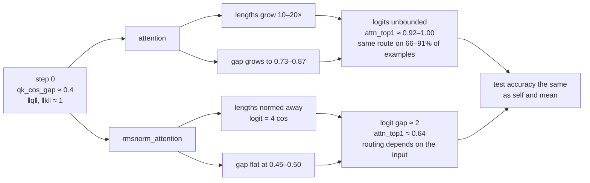

# Study: QK-norm in the channel's attention

Does normalising the query and key stop the channel's attention from
collapsing, and does a channel whose attention does not collapse beat the
controls? Part of the [channel ladder](channel-ladder.md); the decision to
add the mixer is in the [docket](../docket.md) (2026-11-06).

## Setup

The runs cover every mixer at levels 1 and 3, in both directions, on trial
seeds 0–4. They are logged to
the `v3` experiment, tagged `study=channel-ladder`, `level` and `mixer`, with
arms named `{fwd,bwd}-{level}-{mixer}`.

| axis | values |
|---|---|
| direction | forward, `stage1 → stage2`; backward, `stage2 → stage1`, one round |
| level | `1` (`linear_taper` encoder and decoder), `3` (`linear_taper_gelu` both) |
| mixer | `attention`, `rmsnorm_attention`, `self`, `mean` |
| trial seeds | 0–4, so $n = 5$ per arm |

Everything else is held fixed: `cnn3` experts, $M = 3$, class skew
$\alpha = 1$, `fashion`, $r = 8$, $d_k = 16$, $d_v = 64$, `--loss ensemble`,
learning rate $10^{-3}$, batch 128, **10 joint epochs**. Within a direction
and level the arms differ only in `channel.mixer`. A trial seed gets the same
pool in every arm, so arms are compared seed by seed.

Each run is boiled down by the rule in `testbed/results.py`: the median over
the 5 trained epochs around the best joint_val epoch.

### The mixer

`rmsnorm_attention` ([Channel](../testbed/channel.md)) is `attention` with
each query and key RMS-normed first, with no gain:

$$
\hat q_i = \frac{q_i}{\operatorname{RMS}(q_i)} ,
\quad
\hat k_j = \frac{k_j}{\operatorname{RMS}(k_j)} ,
\qquad
w_{ij} = \operatorname*{softmax}_j \frac{\hat q_i \cdot \hat k_j}{\sqrt{d_k}} .
$$

$\lVert \hat q_i \rVert = \lVert \hat k_j \rVert = \sqrt{d_k}$, so the logit
is $\sqrt{d_k} \cos(q_i, k_j)$ and lies in $[-4, 4]$ at $d_k = 16$. The mixer
has no weights, so the two arms are the same size. Only the direction of a
query or key can change the attention, never its length.

## The new metric: `qk_cos_gap`

Attention can sharpen in two ways: queries and keys grow longer, which scales
every logit, or they turn so that a receiver's query points at one sender's
key and away from the others. `msg_norm/query` and `msg_norm/key` measure the
first. `qk_cos_gap` ([Metrics](../testbed/metrics.md)) measures the second:

$$
\texttt{qk_cos_gap} = \operatorname*{mean}_{n,r} \left( \max_s \cos(q_{n,r}, k_{n,s}) - \min_s \cos(q_{n,r}, k_{n,s}) \right) ,
$$

| symbol | meaning |
|---|---|
| $n$ | an example of joint_val |
| $r$, $s$ | a receiving and a sending expert; $s$ includes $r$ itself |
| $q_{n,r}$, $k_{n,s}$ | the query and key as the encoder sent them, before any norm in the mixer |

It lies between 0 and 2, is logged on joint_val per site (`qk_cos_gap/ex0`,
`qk_cos_gap/ex0/round0`), and only for mixers with weights.

For one receiver, the gap is how much more its query points at the key it
matches best than at the key it matches worst, by angle alone:

| value | what the receiver's query looks like | what it means for routing |
|---|---|---|
| near 0 | at the same angle to every sender's key | by direction, it cannot tell the senders apart; any preference has to come from lengths |
| around 0.5 | somewhat closer to one key than another | a moderate preference by direction |
| near 2 | along one sender's key and opposite another's | by direction, it separates the senders as far as it can |

Over training, a **growing** gap means the queries and keys are turning to
separate the senders more each epoch; a **flat** gap means they keep the
separation they had and only their lengths can change. Read it with the
norms: entropy falling while the gap is flat and the norms grow is
sharpening through lengths; a growing gap is sharpening through directions.

Under `rmsnorm_attention` the gap fixes how sharp attention can be. The logit
is $\sqrt{d_k} \cos = 4 \cos$, so a gap $g$ is a logit gap of $4g$ between a
receiver's best and worst sender. With $M = 3$ and the third sender halfway
between, $g = 0.5$ gives the best sender a weight of
$e^2 / (e^2 + e + 1) \approx 0.66$.

All three are measured on what the encoder sent. Under `rmsnorm_attention`
the norms can still grow, but the mixer no longer sees them.

## Hypotheses

The issues that led here: queries and keys grew in norm every epoch
(docket, 2026-11-06), and in the pilot attention added nothing over its
`self` control (level 1 − self, −0.05 ± 0.15 forward, −0.09 ± 0.16 backward).

- **H1, mechanism.** Plain attention sharpens mainly through query and key
  lengths. QK-norm removes that route, so attention stays soft and routing
  stays input-dependent.
- **H2, accuracy.** If the collapse was what kept attention level with the
  controls, `rmsnorm_attention` beats `attention`, `self` and `mean` on test
  accuracy.

## Results

Values are the run's number (median around its best epoch), then the mean ±
SE over the 5 trial seeds. Accuracies are in points (×100).

### H1: attention no longer collapses, but not only for the reason expected

| setting | mixer | `attn_top1` | `attn_entropy` | `qk_cos_gap` | `msg_norm/query` | `routing_mode_share/joint` | `route_flip_rate` |
|---|---|---|---|---|---|---|---|
| fwd 1 | attention | 1.00 ± 0.00 | 0.01 ± 0.00 | 0.87 ± 0.04 | 26.7 ± 2.8 | 0.82 ± 0.11 | 0.12 ± 0.07 |
| fwd 1 | rmsnorm | 0.63 ± 0.02 | 0.83 ± 0.03 | 0.45 ± 0.04 | 19.6 ± 1.0 | 0.33 ± 0.09 | 0.27 ± 0.04 |
| fwd 3 | attention | 0.98 ± 0.01 | 0.06 ± 0.02 | 0.76 ± 0.05 | 15.7 ± 4.3 | 0.80 ± 0.12 | 0.06 ± 0.04 |
| fwd 3 | rmsnorm | 0.64 ± 0.01 | 0.81 ± 0.02 | 0.50 ± 0.02 | 11.3 ± 0.7 | 0.59 ± 0.11 | 0.12 ± 0.03 |
| bwd 1 | attention | 0.99 ± 0.00 | 0.02 ± 0.01 | 0.82 ± 0.04 | 20.1 ± 2.6 | 0.66 ± 0.09 | 0.14 ± 0.04 |
| bwd 1 | rmsnorm | 0.65 ± 0.04 | 0.80 ± 0.06 | 0.50 ± 0.06 | 18.4 ± 1.3 | 0.50 ± 0.12 | 0.19 ± 0.05 |
| bwd 3 | attention | 0.92 ± 0.06 | 0.18 ± 0.13 | 0.73 ± 0.09 | 12.2 ± 3.1 | 0.91 ± 0.07 | 0.05 ± 0.03 |
| bwd 3 | rmsnorm | 0.64 ± 0.02 | 0.80 ± 0.03 | 0.48 ± 0.03 | 10.2 ± 0.3 | 0.42 ± 0.06 | 0.16 ± 0.02 |

At step 0, before training, `qk_cos_gap` is 0.39–0.42 and the query norm
1.0–1.7. `attn_entropy` runs from 0 (one sender) to $\log 3 \approx 1.10$
(uniform); `attn_top1` from 1/3 to 1.

- **Plain attention collapses within the first epoch** and stays collapsed:
  `attn_top1` 0.92–1.00, and the same routing on 66–91% of examples.
- **It sharpens through both routes.** Query norms grow 10–20×, and
  `qk_cos_gap` roughly doubles, from about 0.4 to 0.73–0.87. Lengths alone do
  not explain the collapse.
- **QK-norm stops both.** `qk_cos_gap` rises a little in the first epoch,
  from about 0.4 to 0.45–0.50, and then stays flat. After that first epoch
  the queries and keys do not turn to separate the senders any further: each
  receiver keeps a moderate preference by direction, never a sharp one. With
  lengths removed, that flat gap caps the logit gap at about $4 \times 0.5 = 2$,
  which is why `attn_top1` settles at about 0.64 instead of 1. Routing
  depends on the input more (`routing_mode_share` 0.33–0.59) and keeps
  changing between epochs.
- **Raw norms still grow under QK-norm**, to about 10–20, with a 2–10×
  smaller spread over seeds. The value norm grows by about as much, so the
  growth looks like it comes from the encoder's shared readings layer rather
  than the query and key heads.
- At step 0 `rmsnorm_attention` is already sharper (`attn_top1` 0.58 against
  0.36): the small initial queries and keys are rescaled to RMS 1.

H1 holds for its outcome (no collapse), but plain attention's sharpening is
not only through lengths.

### H2: no accuracy gain

Test accuracy:

| setting | attention | rmsnorm_attention | self | mean |
|---|---|---|---|---|
| fwd 1 | 90.18 ± 0.12 | 90.27 ± 0.14 | 90.18 ± 0.13 | 90.29 ± 0.16 |
| fwd 3 | 90.16 ± 0.14 | 90.14 ± 0.17 | 90.17 ± 0.17 | 90.20 ± 0.15 |
| bwd 1 | 90.16 ± 0.18 | 90.25 ± 0.16 | 90.26 ± 0.18 | 90.36 ± 0.18 |
| bwd 3 | 90.21 ± 0.18 | 90.17 ± 0.23 | 90.12 ± 0.22 | 90.26 ± 0.17 |

Paired by trial seed:

| setting | rmsnorm − attention | rmsnorm − self | rmsnorm − mean | attention − self | mean − self |
|---|---|---|---|---|---|
| fwd 1 | +0.09 ± 0.07 | +0.10 ± 0.03 | −0.02 ± 0.09 | 0.00 ± 0.06 | +0.11 ± 0.08 |
| fwd 3 | −0.02 ± 0.06 | −0.04 ± 0.03 | −0.06 ± 0.03 | −0.02 ± 0.06 | +0.02 ± 0.03 |
| bwd 1 | +0.08 ± 0.05 | −0.01 ± 0.05 | −0.12 ± 0.08 | −0.10 ± 0.05 | +0.10 ± 0.07 |
| bwd 3 | −0.04 ± 0.06 | +0.04 ± 0.03 | −0.09 ± 0.07 | +0.08 ± 0.05 | +0.14 ± 0.05 |

- No difference reaches 0.2 points, and no mixer leads in every setting.
  `rmsnorm_attention` − `attention` is nominally positive at level 1 and
  negative at level 3, each under 1.7 SE.
- The largest ratios, fwd 1 rmsnorm − self (+0.10 ± 0.03, 5 of 5 seeds) and
  bwd 3 mean − self (+0.14 ± 0.05), are 2 of 24 paired tests at $n = 5$,
  about what chance gives, and neither repeats in the other settings.
- `mean` is nominally the best mixer in three of four settings.
- joint_val accuracy shows the same picture (90.64–90.87 for every arm).

H2 is not supported. At 5 seeds, which resolve about ±0.2 points (docket),
any effect of QK-norm on accuracy is smaller than that.

### Where the errors sit

`answer_grid` on test, at step 0 (bagging, the same for every arm) and at the
picked epochs:

| cell | step 0 | trained arms, range over all 16 | rmsnorm − attention, paired (fwd 1 / fwd 3 / bwd 1 / bwd 3) |
|---|---|---|---|
| `all_right` | 69.06 ± 2.06 | 78.6–79.8 | — |
| `some_right_avg_right` | 18.53 ± 1.20 | 10.5–11.6 | — |
| `some_right_avg_wrong` | 7.87 ± 1.51 | 4.75–5.12 | −0.10 ± 0.06 / +0.05 ± 0.06 / −0.18 ± 0.06 / −0.07 ± 0.05 |
| `none_right_avg_wrong` | 4.54 ± 0.43 | 4.68–4.96 | +0.03 ± 0.11 / −0.07 ± 0.08 / +0.09 ± 0.07 / +0.07 ± 0.03 |
| `none_right_avg_right` | 0.01 | 0.00–0.01 | — |

`joint_answer_shift` on test: `corrected` 4.43–4.91, `corrupted` 1.88–2.17,
`net` 2.52–2.77 in every arm; `agreement` rises from 80.2 to 87.5–88.5, and
`expert_accuracy` from 83.6 to 87.7–88.2.

- Every arm, `self` included, makes the same moves: about 3 points out of
  `some_right_avg_wrong`, about 10 from `some_right_avg_right` to
  `all_right`, and +4.5 on the experts' own accuracy. A `self` channel hears
  no one, so these are each expert's own add-on, not communication.
- `none_right_avg_wrong` rises slightly in every arm: nothing fixes examples
  no expert knew.
- In three of four settings `rmsnorm_attention` takes 0.1–0.2 more out of
  `some_right_avg_wrong` than `attention` and adds about as much to
  `none_right_avg_wrong`, leaving accuracy unchanged. A hint at most.

### Whom receivers listen to

`routed_correct` on joint_val, attention / rmsnorm_attention:

| setting | `all` | `corrected` | `corrupted` |
|---|---|---|---|
| fwd 1 | 82.1 / 83.5 | 72.5 / 73.7 | 48.4 / 49.1 |
| fwd 3 | 83.8 / 83.8 | 70.1 / 69.5 | 48.7 / 48.0 |
| bwd 1 | 84.6 / 83.2 | 70.7 / 64.7 | 54.3 / 51.5 |
| bwd 3 | 84.5 / 84.7 | 74.3 / 72.1 | 46.7 / 43.7 |

Two fwd 1 attention runs logged an empty `corrected` or `corrupted` subset in
their window and are left out of those cells.

`all` matches the experts' accuracy before communication (83.9 on
joint_val), which is about what listening at random scores. `corrected` sits
below `all` rather than above it, with both mixers. Corrected receivers were
wrong, so their examples are harder and the other experts are also more often
wrong on them; the metric does not control for that. Softening the attention
did not change any of it.

## Conclusion

QK-norm fixes the mechanical issue: attention stops collapsing to a near-fixed
one-hot route, through lengths and, as `qk_cos_gap` shows, through directions.
It does not fix the substantive one: soft, input-dependent routing still adds
nothing measurable over `self` or `mean`. So the saturated softmax was not
what held attention level with the controls.

## Caveats

- 10 joint epochs, not the docket's 30. Up to 3 of 5 seeds per arm had their
  best epoch at the last one, and accuracy was still creeping up at epoch 10.
- $n = 5$ resolves about ±0.2 points; 24 paired comparisons at that $n$ will
  throw up one or two nominal hits by chance.
- joint beat joint_val by 0.7–1.6 points at the picked epochs in every arm.

## Next

- 30 epochs and 15 trial seeds (the docket's default), to resolve below ±0.2.
- $r = 32$, per the docket's rule for the GELU levels, in case the channel is
  too narrow for routing to matter.
