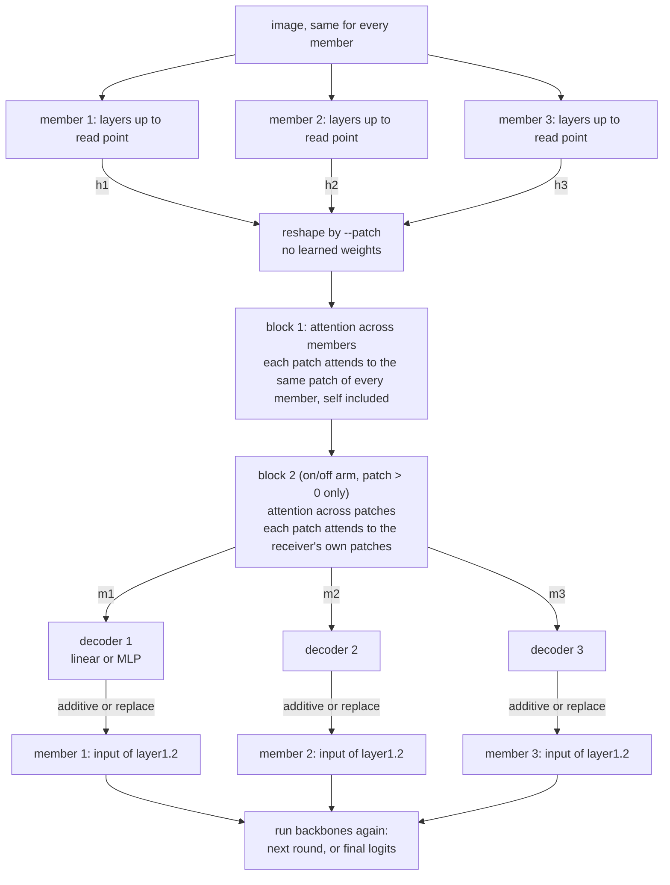

# 04 Second attention block across patches (plan)

## Question

Does a second attention block that mixes across patches help? And how do the decoder (linear vs MLP) and the injection (additive vs replace) change the result?

## Words used below

| Word | Meaning |
|---|---|
| member | one frozen backbone in the ensemble. We use 3. |
| read point | where the hidden state is taken from: output of `layer3.0`, shape 64 channels × 8 × 8. |
| write point | where the message goes back in: input of `layer1.2`, shape 16 channels × 32 × 32. |
| patch | one piece of the read-point grid, set by `--patch`. |
| round | one full forward pass of every backbone. K = number of communication rounds. |

## Architecture (one round, 3 members)

When block 2 is off, block 1's output goes straight to the decoders.

Final prediction: average of the 3 members' softmax probabilities (same as now).

## Shapes, step by step

| Symbol | Meaning |
|---|---|
| b | batch size |
| n | number of members (3) |
| P | number of patches per member, set by `--patch` |
| d | size of each patch's vector, set by `--patch` |
| d_k | query/key size (`--key-dim`, 16) |

| `--patch` | What happens to the 64 × 8 × 8 state | P | d |
|---|---|---|---|
| 0 | average over the whole grid | 1 | 64 |
| 1 | every grid cell is a patch | 64 | 64 |
| 2 | 2 × 2 blocks, each flattened | 16 | 256 |

Block 1, across members:

| Step | Operation | Shape |
|---|---|---|
| 1 | stack members' reshaped states | h: (b, P, n, d) |
| 2 | Q = h·W_q, K = h·W_k, V = h·W_v | Q, K: (b, P, n, d_k), V: (b, P, n, d) |
| 3 | A = softmax over the n members of Q·Kᵀ / √d_k | A: (b, P, n, n) |
| 4 | m = A·V | m: (b, P, n, d) |

Block 2, across patches (input is block 1's output m):

| Step | Operation | Shape |
|---|---|---|
| 5 | Q₂ = m·W_q2, K₂ = m·W_k2, V₂ = m·W_v2 | Q₂, K₂: (b, n, P, d_k), V₂: (b, n, P, d) |
| 6 | A₂ = softmax over the receiver's P patches of Q₂·K₂ᵀ / √d_k | A₂: (b, n, P, P) |
| 7 | m′ = A₂·V₂ | m′: (b, P, n, d) |

Then:

| Step | Operation | Shape |
|---|---|---|
| 8 | decoder of receiver i maps its message to the write-point shape | (b, 16, 32, 32) |
| 9 | additive: `x + decoder output`. replace: `decoder output` instead of x | |

## Init

| Weight | Init |
|---|---|
| W_q, W_k (both blocks) | standard (PyTorch `nn.Linear`) |
| W_v (both blocks) | identity, shape d × d, learned. At step 0, V = the hidden state itself. |
| decoder, additive arms | last layer zero, so step 0 = the plain ensemble |
| decoder, replace arms | standard, since zero would wipe the receiver's state |

Decoders: linear = one `nn.Linear`. MLP = the current `Linear → GELU → Linear`.

## Arms

| patch | block 2 | decoder | injection | arms |
|---|---|---|---|---|
| 0 | off | linear, MLP | additive | 2 |
| 1 | on, off | linear, MLP | additive, replace | 8 |
| 2 | on, off | linear, MLP | additive, replace | 8 |

18 arms × 3 seeds = 54 runs.

- Patch 0 has no block 2: with one patch there is nothing to mix across.
- Patch 0 has no replace: its message is one 64-vector with no spatial layout, so it cannot replace a 16 × 32 × 32 state without either copying 16 values to every pixel or a ~1M-parameter decoder per member.

## Training setup (from experiment 03)

- Experts: `selection/manifests/encoder_study_group.json`
- Encoder `qkv`, `key_dim 16`, taps `layer1.2` / `layer3.0`, K = 1
- Backbones frozen, `--freeze-fc`, `--patience 10`, 70 epochs max
- AdamW lr 1e-3, weight decay 1e-4
- Seeds: 476981973, 621715752, 1882162633

## Baseline

K = 0 (no communication) = untrained probability averaging: test 0.6652.

## Code changes

- `bus.py`: W_v initialized to identity, value size = d. Block 2 across patches. Linear decoder option.
- `hooks.py`: `hook_replace`, returns the decoder output instead of `input + output`.
- `train.py`: flags `--patch-attn`, `--decoder {mlp,linear}`, `--inject {add,replace}`. Decoder init chosen by injection.
- `train.py` logging: block 1 attention metrics as now. Block 2 attention has shape (b, n, P, P), so only its entropy is tracked. Block 2 and the new decoders get their own `grad_norm` component.
- `experiments/04_patch_attention/`: README, `run.sh`, `commands.md`.
