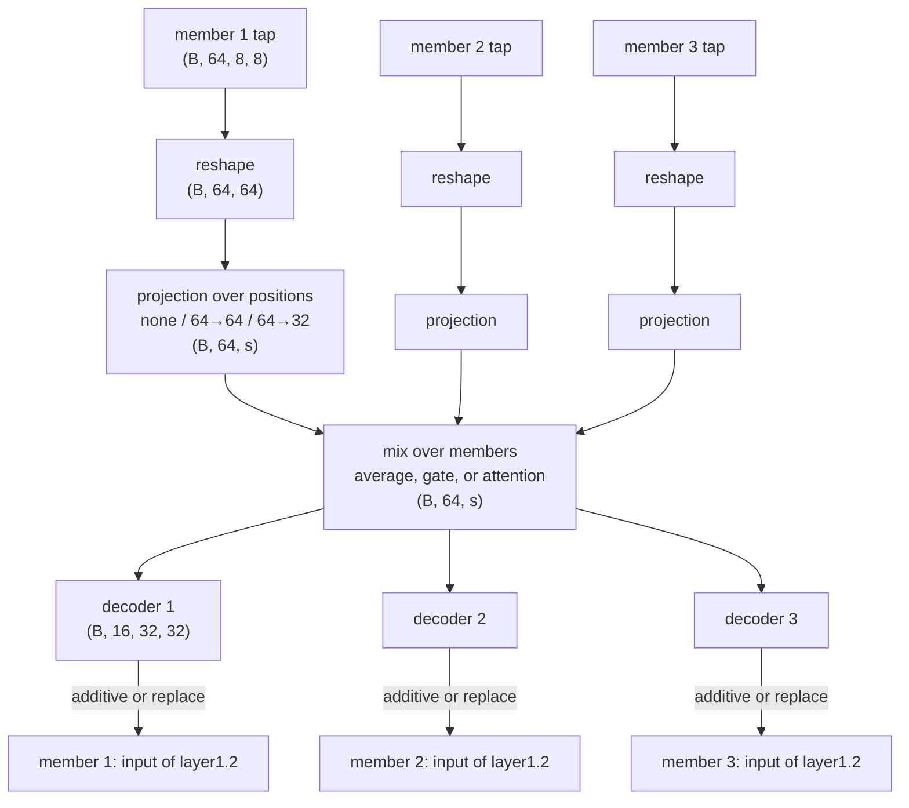

# 05 Minimal message exchange (plan)

## Question

How much does the way members are mixed matter? Messages are mixed by a plain average, a learned gate (like an MoE router), or attention. Everything else in the pipeline is the same, so the arms differ only in the mixing.

Attention is run twice: with standard init, which starts far from uniform, and with the query heads started at zero (`attention_zq`), which starts as the average, like the gate. This separates what attention learns from where it starts.

## Words used below

| Word | Meaning |
|---|---|
| member | one frozen backbone in the ensemble. We use 3. |
| read point | where the hidden state is taken from: output of `layer3.0`, shape (64 channels, 8, 8). |
| write point | where the message goes back in: input of `layer1.2`, shape (16 channels, 32, 32). |
| position | one cell of a spatial grid. The read point has 8 × 8 = 64 positions. |
| B | batch size |

## Pipeline (one round, 3 members)



s = number of positions after the projection: 64 (none or 64→64) or 32 (64→32).

Final prediction: average of the 3 members' softmax probabilities (same as now).

## Shapes, step by step

| Step | Operation | Shape |
|---|---|---|
| 1 | tap at read point | (B, 64, 8, 8) |
| 2 | reshape: flatten the 8 × 8 grid | (B, 64, 64) |
| 3 | projection over positions (channels untouched) | (B, 64, s) |
| 4 | mix over the 3 members | (B, 64, s) |
| 5 | decoder, positions: s → 32 · 32 | (B, 64, 1024) |
| 6 | decoder, channels: 64 → 16 | (B, 16, 1024) |
| 7 | reshape | (B, 16, 32, 32) |
| 8 | additive: add to the input of `layer1.2`. replace: use instead of it. | |

### Step 3: projection

| Option | Weights | Output |
|---|---|---|
| none | no weights, just the reshape | (B, 64, 64) |
| 64→64 | learned matrix (64, 64) | (B, 64, 64) |
| 64→32 | learned matrix (32, 64) | (B, 64, 32) |

Each output position is a learned weighted sum of the 64 grid cells. The same matrix is used for all 64 channels.

Init: 64→64 starts as the identity, so those arms start exactly as the none arms. 64→32 starts as the average of each pair of horizontally adjacent cells (8 × 8 → 8 × 4). Both start as a fixed spatial operation and are learned from there.

### Step 4: mixing

- **average:** message = (x₁ + x₂ + x₃) / 3
- **gate:**
  1. score_j = w_j · flatten(x_j), from 64 · s numbers to 1. One score per member, each member with its own w_j.
  2. g = softmax(score₁, score₂, score₃). Three weights that sum to 1, different for every image.
  3. message = g₁·x₁ + g₂·x₂ + g₃·x₃
  4. The gate's linear layer starts at zero, so g = (1/3, 1/3, 1/3) at step 0. The gate arm starts out identical to the average arm.

Average and gate give **every receiver the same message**. Only the receivers' decoders differ.

- **attention:**
  1. q_i = W_q,i · flatten(x_i), k_j = W_k,j · flatten(x_j), each from 64 · s numbers to d_k = 16. Every member has its own W_q and W_k.
  2. A_i = softmax over j of (q_i · k_j / √d_k). Receiver i's three weights, self included, summing to 1.
  3. message_i = A_i1·x₁ + A_i2·x₂ + A_i3·x₃
  4. No value map: the message is made of the projected states x_j themselves, as in average and gate.
  5. W_q, W_k: standard init (PyTorch `nn.Linear`). The layer3.0 features are not normalized, so this start is far from uniform (e.g. 0.79 / 0.19 / 0.02).
  6. attention_zq arms: same, but W_q starts at zero. Every score is then 0, so attention starts as the average, like the gate. The random keys still give W_q a gradient.

Attention is the gate with one difference: **each receiver gets its own weights**, so each receiver gets its own message.

### Steps 5 to 7: decoder

| Decoder | Steps |
|---|---|
| linear | positions map (1024, s) → channels map (16, 64) |
| MLP | positions map (1024, s) → GELU → channels map (16, 64) |

Init:

- additive arms: channels map starts at zero, so step 0 = the plain ensemble.
- replace arms: standard init, since zero would wipe the receiver's state.

## Arms

| mixing | projection | decoder | injection | arms |
|---|---|---|---|---|
| average | none, 64→64, 64→32 | linear, MLP | additive, replace | 12 |
| gate | none, 64→64, 64→32 | linear, MLP | additive, replace | 12 |
| attention | none, 64→64, 64→32 | linear, MLP | additive, replace | 12 |
| attention_zq | none, 64→64, 64→32 | linear, MLP | additive, replace | 12 |

48 arms × 3 seeds = 144 runs.

Attention arms have about 3× the trainable parameters of the others (about 600k vs 110k to 230k): each member's query and key heads read the whole flattened map.

## Training setup (same as experiment 04)

- Experts: `selection/manifests/encoder_study_group.json`
- Taps `layer1.2` / `layer3.0`, K = 1 (one exchange)
- Backbones frozen, `--freeze-fc`, `--patience 10`, 150 epochs max. Experiment 04 used 70, but its arms that converged stopped well before that, so the higher cap only changes arms that are still improving.
- AdamW lr 1e-3, weight decay 1e-4
- Seeds: 476981973, 621715752, 1882162633

## Projection is per member

Each member j has its own projection matrix P_j:

```
message = average(P₁·x₁, P₂·x₂, P₃·x₃)
```

Each P_j can learn how to line up member j's features with the others before mixing. (With one shared P, P could be moved outside the average and merged into the decoder, so the 64→64 arms would be the same model as the none arms.)

## Known limit: replace gives the receiver a coarser map (no action needed)

| | Values per channel |
|---|---|
| real input of `layer1.2` | 32 × 32 = 1024 |
| decoder output | a weighted sum of at most s (64 or 32) learned 32 × 32 maps |

With replace, the receiver's own detailed state is swapped for this coarser one. This comes from reading at 8 × 8 and writing at 32 × 32, and experiment 04's replace arms have the same limit. It is one possible reason replace could lose to additive. Keep it in mind when reading the results.

Experiments 04 and 05 both keep `layer3.0` → `layer1.2` so they can be compared. A later experiment sweeps the tap pair, e.g. `layer3.17` out → `layer3.1` in, where read and write have the same shape and this limit goes away.

## Code changes

- `bus.py`, block `05_minimal_exchange`: `MinimalEncoder` (position projection, per-member gate or query/key heads), `MinimalDecoder` (positions map, optional GELU, channels map), `AverageBus`, `GateBus`. Attention reuses `TarMACBus`.
- `orchestrator.py`: encoders may return no Q/K, and buses may return no weights (average). Attention stats are skipped when there are no weights.
- `train.py`: new subcommand `minimal` (`--mix`, `--proj`, `--decoder linear|mlp`, `--zero-query`), built by `build_minimal_communicative`. Arguments shared by all methods and the train/evaluate/save step were extracted so both subcommands use them.
- `train.py` logging: `mix_weight` per sender and `self_weight` for any bus that reports weights (gate, attention). `proj` and `score_head` get their own `grad_norm` component. Replace uses `INJECTIONS["replace"]` from experiment 04.
- `experiments/05_minimal_exchange/`: `run.py`, `commands.md`.
